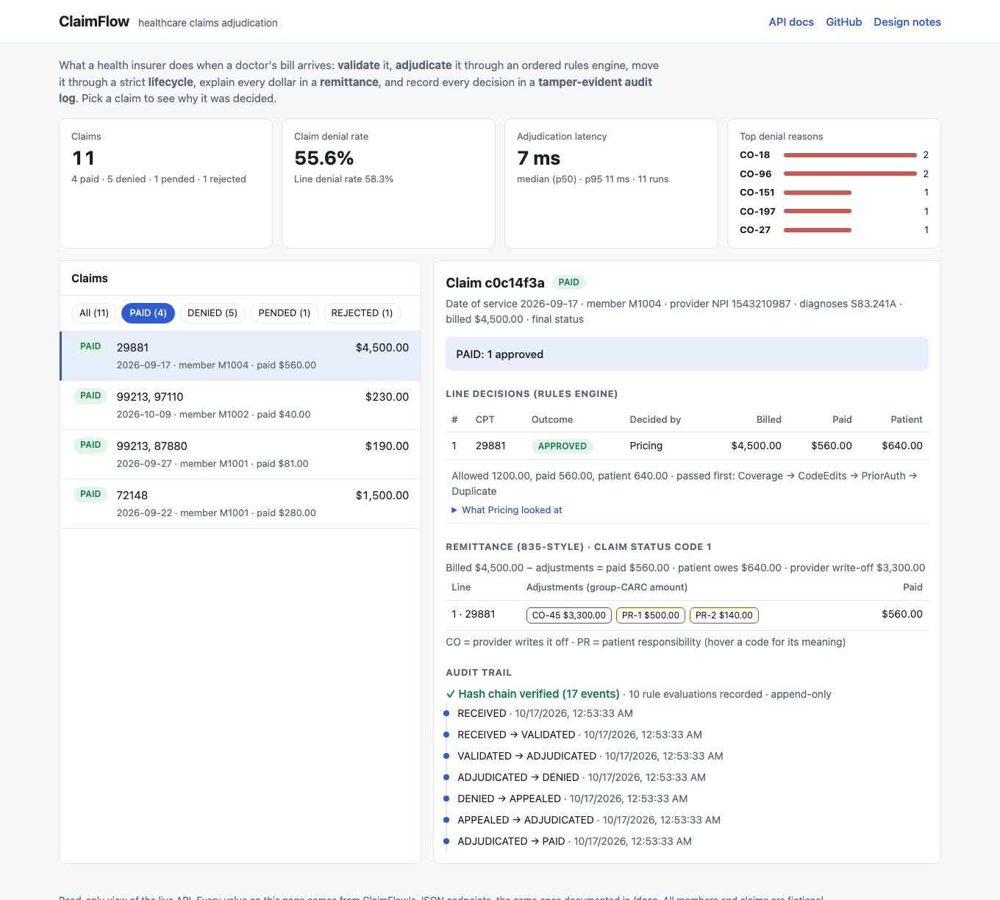
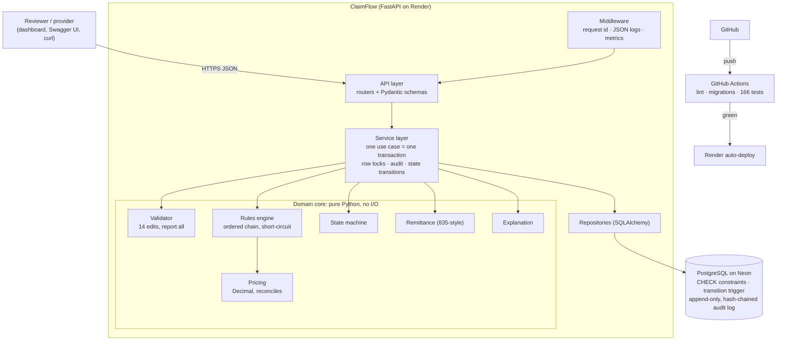
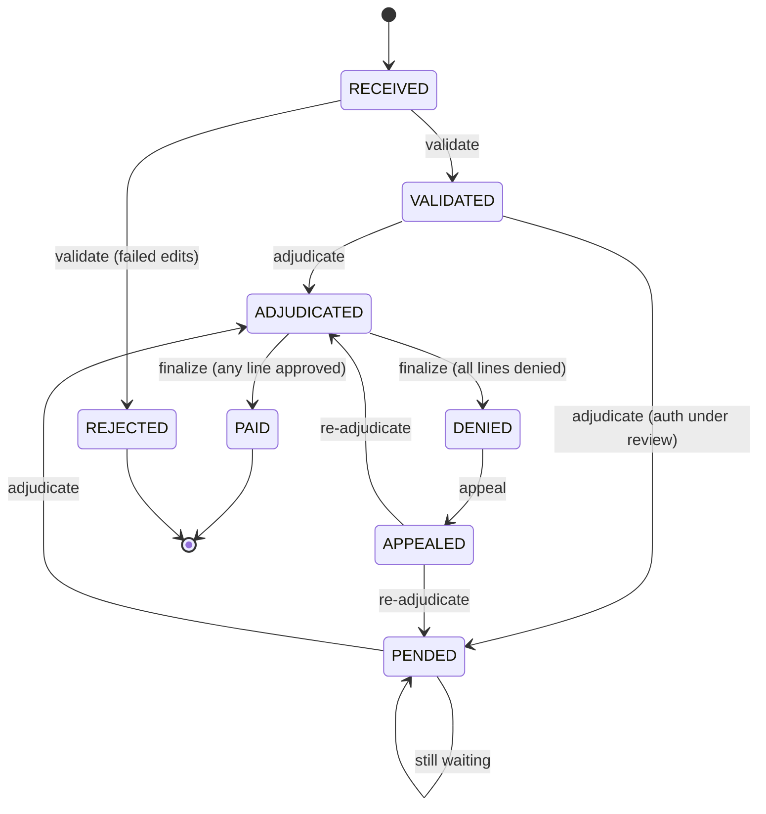

# ClaimFlow

[](https://github.com/taran050701/claimflow/actions/workflows/ci.yml)


**A healthcare claims adjudication backend: what a health insurer's systems do
when a doctor's bill arrives.** ClaimFlow validates medical claims, decides
what to pay through an ordered rules engine, tracks every claim through a strict
lifecycle, explains every dollar with industry reason codes, and keeps a
tamper-evident audit trail of every decision.

**▶ Live demo: [claimflow-vpno.onrender.com](https://claimflow-vpno.onrender.com)** (dashboard) · [API docs](https://claimflow-vpno.onrender.com/docs)
*(free hosting: the first request after idle takes ~30–60 s to wake the server)*

---

## What it does, in one example

A patient gets a lumbar MRI. The imaging center bills **$1,500**.

| Step | ClaimFlow | Result |
|---|---|---|
| **Validate** | Is the member real? Is the NPI valid? Are the codes (CPT `72148`, ICD-10 `M54.50`) valid *on the date of service*? | ✅ VALIDATED |
| **Adjudicate** | Eligibility → Coverage → Code edits → Prior auth → Duplicate check → Pricing | ✅ approved |
| **Price** | Contracted rate $600 · patient has $250 deductible left · 20% coinsurance | payer **$280**, patient **$320**, provider writes off **$900** |
| **Remit** | Every unpaid dollar gets a reason code: `CO-45 $900`, `PR-1 $250`, `PR-2 $70` | balances to the cent |
| **Audit** | 10 hash-chained events record which rule decided what, and what it looked at | verifiable |

Had the prior authorization been missing, the claim would be **DENIED with
`CO-197`**, and `GET /claims/{id}/explanation` answers *why* in one line.

## Try it in 2 minutes

[](https://claimflow-vpno.onrender.com)

Open the [live demo](https://claimflow-vpno.onrender.com). It's preloaded with 11 claims covering every path:
paid, denied (no auth, not covered, duplicate, terminated coverage, too many
units), partially paid, pended, rejected, and an appeal that was overturned.
Click any claim to see **why** it was decided: the deciding rule and what it
looked at, the remittance with reason codes, and the verified audit trail.

The dashboard is a read-only client of the JSON API. To explore the API itself,
open [`/docs`](https://claimflow-vpno.onrender.com/docs):

1. `GET /claims`: browse the demo claims
2. `GET /claims/{id}/explanation` on a **DENIED** claim: the rule, reason code
   and inputs behind the decision
3. `GET /claims/{id}/remittance` on a **PAID** claim: every dollar explained
4. `GET /claims/{id}/audit/verify`: proof the audit trail is untampered
5. `GET /stats`: denial rate, top denial reasons, adjudication latency p50/p95

Or submit your own: `POST /claims` → `/validate` → `/adjudicate` → `/finalize`.
Every response lists the claim's `allowed_actions`.

## Architecture



The **domain core never imports FastAPI or SQLAlchemy**: rules, pricing, the
state machine and the remittance builder are pure functions over plain
dataclasses, unit-tested in milliseconds with no database
(ports-and-adapters / clean architecture).

### Claim lifecycle



Illegal transitions return **409** with the allowed actions, and are also
blocked by a **database trigger**, so even raw SQL can't skip a step.

## Engineering highlights

| Decision | Why |
|---|---|
| **Store every submission, reject with reasons** (no FK from claims to members) | A bad claim must never vanish; validation marks it REJECTED with real CARCs |
| **Idempotency keys** + UNIQUE constraint + body hash | Network retries never create duplicate claims, even when racing (409 on key reuse with a different body) |
| **Validation collects all errors; rules engine short-circuits** | Providers fix everything in one resubmission; later rules are meaningless after an earlier failure |
| **Rules as Strategy objects in an ordered chain**, each recording its inputs | Add a rule without touching the engine; every decision is explainable |
| **`Decimal` / `NUMERIC(12,2)`, round once, payer gets the remainder** | Money reconciles to the cent: enforced by tests, DB CHECK constraints, and the remittance builder |
| **Row lock on the member's accumulator** | Two claims can't double-spend a deductible, and duplicates can't both slip through |
| **Single transition table + one `_transition()` path + DB trigger** | Every status change is validated and audited; defense in depth |
| **Append-only audit log with a per-claim SHA-256 hash chain** | Edits, deletions and re-hashing are detected; `verify` endpoint |
| **Effective-dated coverage and code sets** | "Was the member covered / was the code valid **on the date of service**?" |
| **Structured logs + Prometheus metrics + DB-backed stats** | request_id and correlation_id join logs to audit rows; no ids in metric labels |

Every decision is explained in depth, with interview-style questions and
answers, in **[docs/LESSONS.md](docs/LESSONS.md)**.

## Tech stack

| | Choice | Why |
|---|---|---|
| Language | Python 3.13 | Fast iteration; type hints + Pydantic for safety |
| API | FastAPI | Automatic OpenAPI/Swagger docs from type hints |
| Database | PostgreSQL 18 (Neon; works on 16+) | Transactions, `NUMERIC` money, constraints, triggers, JSONB |
| ORM / migrations | SQLAlchemy 2 + Alembic | Industry standard; reviewed, reversible migrations |
| Tests | pytest (+ pytest-cov) | Pure unit tests + integration tests against real Postgres |
| Observability | structlog, prometheus-client | JSON logs, metrics with bounded labels |
| Tooling | uv, ruff | Locked dependencies; fast lint/format |
| CI/CD | GitHub Actions → Render | Deploys only commits whose checks passed |
| Hosting | Render (app) + Neon (Postgres) | Both free with no credit card; Neon's free DB doesn't expire |

## Run it locally (≈10 minutes)

**Prerequisites:** Python 3.13, PostgreSQL 16 or newer running locally,
[uv](https://docs.astral.sh/uv/).

```bash
git clone https://github.com/taran050701/claimflow.git && cd claimflow
uv sync                                   # install exact locked dependencies
cp .env.example .env                      # local DB URLs, readable console logs
createdb claimflow && createdb claimflow_test

uv run alembic upgrade head               # build the schema
uv run python -m scripts.demo_seed        # reference data + 11 demo claims
uv run uvicorn claimflow.main:app --reload
# open http://localhost:8000 (dashboard) or /docs (API)

uv run pytest                             # 166 tests against claimflow_test
```

## API overview

| Method | Endpoint | Purpose |
|---|---|---|
| POST | `/claims` | Submit a claim → RECEIVED (`Idempotency-Key` header supported) |
| GET | `/claims`, `/claims/{id}` | List (filter by status/member) / fetch with line decisions |
| POST | `/claims/{id}/validate` | Front-end edits → VALIDATED or REJECTED with reasons |
| POST | `/claims/{id}/adjudicate` | Rules engine → ADJUDICATED or PENDED |
| POST | `/claims/{id}/finalize` | Payment release → PAID or DENIED |
| POST | `/claims/{id}/appeal` | DENIED → APPEALED (then re-adjudicate) |
| GET | `/claims/{id}/remittance` | 835-style payment summary with CO/PR reason codes |
| GET | `/claims/{id}/explanation` | Why each line was decided, from the audit log |
| GET | `/claims/{id}/audit`, `/audit/verify` | Hash-chained audit trail / integrity check |
| GET | `/stats` | Claims by status, denial rates, top denial reasons, latency |
| GET | `/metrics`, `/health` | Prometheus metrics / health check |

Full interactive docs at `/docs`.

## Testing and quality

- **166 tests, 99% coverage**, in three layers:
  - **pure unit tests** for validation, pricing, rules, the state machine, remittance and explanations (no DB)
  - **integration tests** through HTTP against real PostgreSQL
  - **property and attack tests**: state-graph reachability, money reconciliation, audit tamper scenarios, metric-cardinality guard
- **CI on every push and PR:** locked install → ruff lint + format →
  migrations apply and match models → migrations reverse cleanly → tests with
  a 95% coverage floor. Actions pinned by commit SHA.

## Project structure

```
src/claimflow/
  domain/          pure business logic: validation, adjudication (rules), pricing,
                   state_machine, remittance, explanation, carc codes
  services/        use cases: transactions, locking, audit, logs, metrics
  repositories/    SQLAlchemy queries; rows -> domain objects
  api/             FastAPI routers;  schemas.py = HTTP contract
  models.py        database schema;  middleware.py, metrics.py, logging_config.py
  static/          index.html: the dashboard (plain HTML + JS, read-only API client)
migrations/        Alembic migrations 0001-0005 (incl. triggers, hash chain)
scripts/           seed.py (reference data), demo_seed.py (demo claims), start.sh
tests/             unit + integration tests
docs/LESSONS.md    design decisions explained, with Q&A
render.yaml        deployment as code
```

## Deployment (free tier)

- **Render** web service from `render.yaml` (Blueprint), with the start script running
  migrations, then the idempotent demo seed, then `exec uvicorn`.
  Deploys only after CI passes.
- **Neon** PostgreSQL (free, no expiry). `DATABASE_URL` is set in Render's
  dashboard and never committed.
- **Limits designed around:** Render sleeps after ~15 min idle (cold start ~30–60 s;
  demo data loading is idempotent, so restarts are harmless); Neon free has
  1 GB storage and scales to zero when idle (`pool_pre_ping` handles dropped
  connections); in-memory metrics reset on restart, so business KPIs come from
  the database (`/stats`).

## Design tradeoffs

- **Synchronous processing** (one HTTP call per lifecycle step) instead of queues:
  simple and easy to reason about at this scale.
- **Remittance computed on read** from stored decisions (one source of truth);
  real payers also store every issued 835 and correct it with reversal/correction pairs.
- **All denials use group code CO.** Real payers often send eligibility denials
  (26/27) as PR so the provider can bill the patient.
- **One fee schedule** for all providers; real contracts vary per provider.
- **Migrations run at startup**, which is fine for a single instance. Multiple
  instances need a separate pre-deploy migration step.

## What I'd do with more time

- Queue-based pipeline (Postgres `SELECT … FOR UPDATE SKIP LOCKED` workers) and batch payment cycles
- X12 837 ingestion and 835 generation
- Anchor the audit hash chain externally; separate least-privilege DB roles
- Line-level appeals, appeal levels and deadlines; provider-specific contracts
- Persist issued remittances with reversal/correction pairs
- Medical-necessity checks (diagnosis ↔ procedure) and NCCI procedure-pair edits
- Authentication (OAuth2 client credentials for providers), rate limiting
- Route uvicorn's own logs through structlog; OpenTelemetry tracing; Grafana dashboard

---

*CPT® is a registered trademark of the American Medical Association. ClaimFlow
seeds a small set of codes with its own short descriptions; ICD-10-CM codes are
public domain. All members and claims are fictional.*
