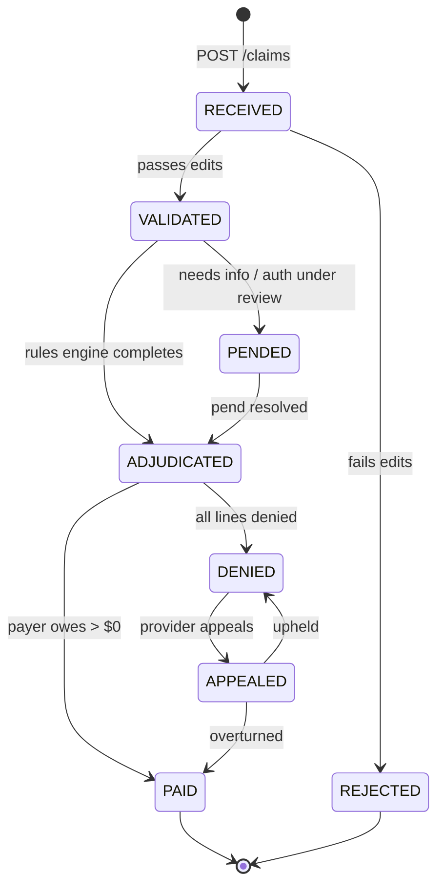
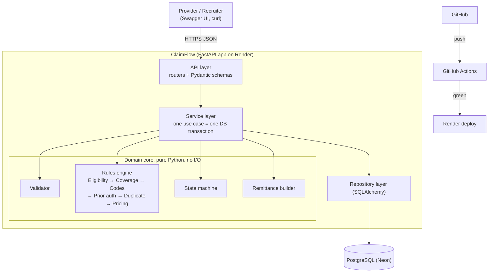
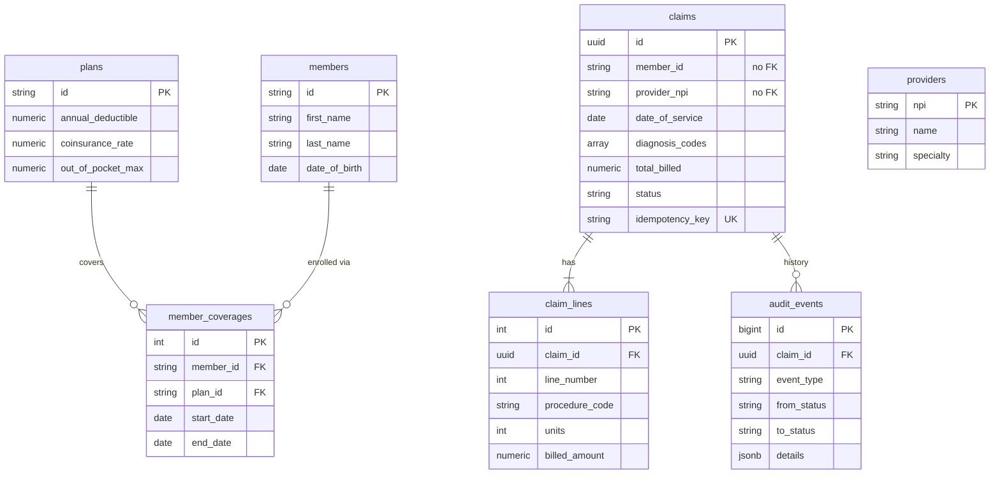
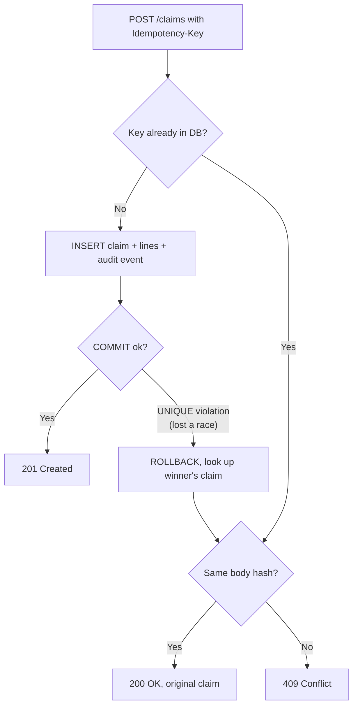
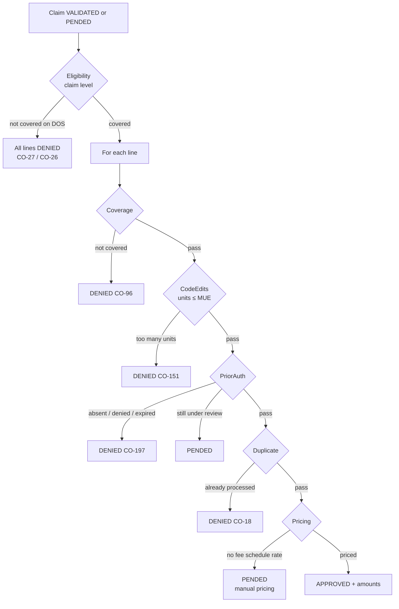
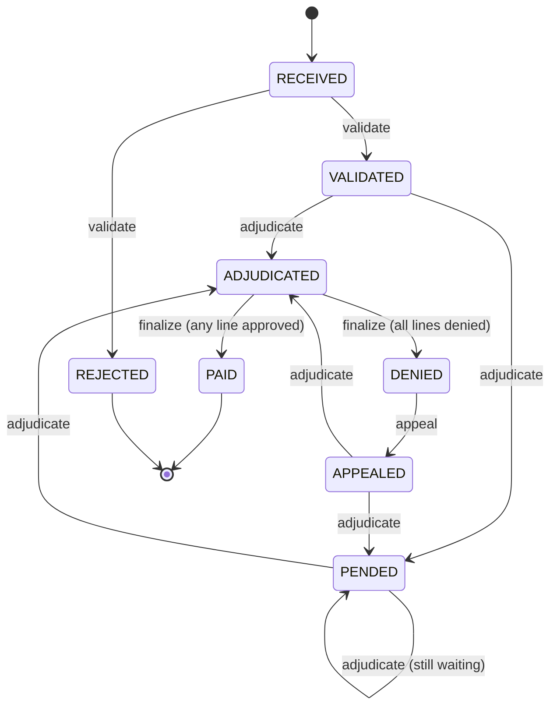

# ClaimFlow: Lessons, Phase by Phase

Study notes for every concept and design decision in ClaimFlow. Each phase has
the plain-English lesson, the decisions we made and why, and **every question**
(interview questions plus the ones asked during our sessions), each with a
collapsible answer. Try answering out loud before opening it. Phases are added
as they're completed.

**Contents**
- [Phase 0: Foundation (domain + architecture)](#phase-0-foundation)
- [Phase 1: Data model + ingestion](#phase-1-data-model--ingestion)
- [Phase 2: Validation](#phase-2-validation)
- [Phase 3: Rules engine](#phase-3-rules-engine)
- [Phase 4: State machine](#phase-4-state-machine)
- [Phase 5: Remittance](#phase-5-remittance)
- [Phase 6: Audit log](#phase-6-audit-log)
- [Phase 7: Quality and observability](#phase-7-quality-and-observability)
- [Phase 8: Ship it](#phase-8-ship-it)
- [Glossary](#glossary)

---

## Phase 0: Foundation

### 0.1 The players

| Who | What they are |
|---|---|
| **Member** | The patient, who has insurance. |
| **Provider** | The doctor, clinic or hospital that gave the care. Identified by a 10-digit **NPI** (National Provider Identifier). |
| **Payer** | The insurance company (e.g. Humana). **ClaimFlow plays this role.** |
| **Plan** | The member's specific coverage. It sets what's covered, the deductible, copays and coinsurance. |

### 0.2 What a claim is

A **claim** is a bill the provider sends to the payer: "I treated your member,
please pay me." In real life it arrives electronically as an **X12 837** file
(837P for professional/doctor services, 837I for institutional/hospital). We
accept JSON over REST instead, but with the same core fields:

| Field | Example | Why it matters |
|---|---|---|
| Member ID | `M1001` | Who received care |
| Provider NPI | `1234567893` | Who gets paid |
| Date of service | `2026-09-14` | Coverage is checked **as of this date**, not today |
| Diagnosis codes (ICD-10) | `M54.50` (low back pain) | **Why** care was needed |
| Procedure codes (CPT) | `72148` (lumbar MRI) | **What** was done |
| Billed amount | `$1,500.00` | What the provider is asking for |

A claim has one or more **line items**, one per procedure. Each line has its own
CPT code and charge. **Real payers adjudicate each line separately**: one line
can be paid while another is denied. ClaimFlow does the same.

### 0.3 CPT vs ICD: the "what" and the "why"

- **ICD-10-CM** codes are **diagnoses** (the *why*), e.g. `E11.9` type 2
  diabetes or `J06.9` upper respiratory infection. Published free by CMS/CDC
  (public domain).
- **CPT** codes are **procedures** (the *what*), 5 digits, e.g. `99213` office
  visit or `80053` metabolic blood panel. **The AMA owns the copyright to CPT**,
  so we seed a small hand-picked set instead of shipping the full list. (Worth
  mentioning in an interview: it shows you know the real-world constraint.)
- The two must make sense together. That check is called **medical necessity**
  (an MRI for a sore throat is suspicious). It's out of scope for us, but know
  the term.

### 0.4 Adjudication

**Adjudication** is the payer deciding, for each claim: *do we pay, how much,
and if not, why not?* It's a sequence of checks:

1. **Eligibility**: was the member covered on the date of service?
2. **Coverage**: does their plan cover this procedure?
3. **Code validity**: are the CPT/ICD codes real?
4. **Prior authorization**: was pre-approval required, and was it obtained?
5. **Duplicate detection**: have we already processed this exact service?
6. **Pricing**: how much does the payer pay, and how much does the patient owe?

### 0.5 The money: billed → allowed → split

**Worked example: lumbar MRI, billed $1,500.** The member's plan has $250 of
deductible remaining and 20% coinsurance.

| Step | Amount | Explanation |
|---|---|---|
| **Billed** | $1,500 | The provider's list price. Almost nobody pays this. |
| **Allowed** | $600 | The provider signed a contract agreeing to a fee schedule. The **$900 difference is written off by the provider**, and the patient owes none of it. |
| **Deductible** | $250 | The patient pays the first $X of covered care each year. They had $250 left. $350 of the allowed amount remains. |
| **CAS / CLP / SVC** | 835 segments: adjustments / claim payment info / service line |
| **CO / PR group codes** | Who owes an unpaid dollar: provider writes off (CO) / patient pays (PR) |
| **CI** | Continuous integration: every push is automatically linted, migrated and tested |
| **Cold start** | Delay while a sleeping free-tier server boots on the first request |
| **Coinsurance** | $70 | After the deductible, the cost is split by percentage: 20% × $350. |
| **Payer pays** | **$280** | $350 − $70 |
| **Patient owes** | **$320** | $250 + $70 |

**Reconciliation check:** 900 (write-off) + 320 (patient) + 280 (payer) =
1,500 (billed). ✓ A remittance must *always* reconcile like this.

Two more terms:
- **Copay**: a flat fee for certain services (e.g. $25 per office visit),
  usually charged *instead of* applying the deductible to that service.
- **Out-of-pocket max**: a yearly cap on what the patient pays. After it's
  reached, the payer covers 100%.

Real plans differ in the order these are applied. ClaimFlow defines one
explicit, documented order. The honest interview answer is: "I made the order
explicit and configurable per plan."

### 0.6 Prior authorization

Expensive services (MRIs, surgeries) often need payer approval **before** they
happen.
- Auth required and none on file → **denied**.
- Auth request still under review → **pended** (parked until it's resolved).

### 0.7 Remittance and reason codes

A **remittance** (real format: **X12 835**, also called ERA) is what the payer
sends back to the provider. It lists billed, allowed, paid and patient
responsibility, plus **reason codes** explaining every dollar not paid. The
member-facing version is the **EOB** (Explanation of Benefits) you get in the
mail.

Reason codes are an industry standard called **CARCs** (Claim Adjustment Reason
Codes). The prefix is the **group code**:
- **CO** = Contractual Obligation → the provider absorbs it
- **PR** = Patient Responsibility → the patient pays it

| Code | Meaning |
|---|---|
| `CO-45` | Charge exceeds fee schedule (the $900 write-off) |
| `PR-1` / `PR-2` / `PR-3` | Patient owes deductible / coinsurance / copay |
| `CO-27` | Service after coverage terminated |
| `CO-96` | Non-covered service |
| `CO-197` | Prior authorization absent |
| `CO-18` | Duplicate claim |
| `CO-16` | Claim lacks information |

### 0.8 Rejected vs denied

| | **Rejected** | **Denied** |
|---|---|---|
| When | Fails basic validation (missing fields, fake codes) | After full adjudication |
| Was it adjudicated? | No, it never entered the rules engine | Yes |
| What the provider does | Fixes and resubmits | Can **appeal** |

The original spec had no place for claims that fail validation, so we added a
**REJECTED** state.

### 0.9 The claim lifecycle (state machine)



### 0.10 Tech stack and why

| Layer | Choice | Why | Alternatives rejected |
|---|---|---|---|
| Language | **Python 3.13** | You know it, it's fast to iterate in, and type hints plus Pydantic give most of Java's safety | **Java/Spring Boot**: authentic for payers, but the boilerplate buries the concepts, and JVM memory/cold starts hurt on 512 MB free hosts |
| Web framework | **FastAPI** | Generates **OpenAPI/Swagger docs automatically** from type hints; request validation via Pydantic | Flask (no validation/docs built in); Django (heavyweight) |
| Database | **PostgreSQL** | Relational data, **transactions**, `NUMERIC` for money, constraints enforced by the DB itself | MongoDB (wrong fit for relational, money-critical data); SQLite (want the same DB in dev and prod) |
| ORM + migrations | **SQLAlchemy 2 + Alembic** | Python industry standard; Java equivalent is JPA + Flyway | Raw SQL (more boilerplate); SQLModel (less mature) |
| Tests | **pytest** | Standard | unittest |
| Tooling | **uv**, **ruff** | Fast, modern package manager and linter/formatter | pip + venv, black + flake8 |
| Logs / metrics | **structlog**, **prometheus-client** | JSON logs are searchable; Prometheus is the metrics default | OpenTelemetry (overkill here) |
| CI | **GitHub Actions** | Free for public repos; runs Postgres as a service | GitLab CI, CircleCI |
| App host | **Render** (free) | Deploys from GitHub; no card needed (to be confirmed at signup) | Fly.io and Cloud Run need a card; Railway is a trial |
| Prod DB | **Neon** (free Postgres) | Doesn't expire (Render's free DB is deleted after ~30 days) | Supabase (pauses inactive projects) |

**Free-tier limits we design around:** Render sleeps after ~15 min idle (first
request takes ~30–60 s); Neon free is 1 GB and scales to zero when idle. Our data is
tiny, so both are fine.

### 0.11 Architecture

**Style: a modular monolith with a "pure core."** It's one deployable app, but
the business logic (rules engine, state machine, pricing) is plain Python that
never imports FastAPI or SQLAlchemy.

Why that matters:
- Every rule can be unit-tested in milliseconds with no database.
- You can explain the business logic without explaining the framework.
- This is the idea behind **hexagonal / ports-and-adapters / clean
  architecture**. Know those names.



### 0.12 Key design principles (previewed)

1. **Money uses `Decimal` / `NUMERIC(12,2)`, never `float`.** In floating
   point, `0.1 + 0.2 != 0.3`, and a payer can't lose pennies.
2. **Rules use the Strategy pattern.** Each rule has the same
   `evaluate(context) -> RuleResult` interface and they run from an ordered
   list. The first failure stops evaluation and returns its reason code. To add
   a rule, you write a class and add it to the list.
3. **The audit event is written in the same transaction as the state change.**
   Neither can exist without the other.
4. **Idempotency ≠ duplicate detection.** A network retry of the same request
   is a *transport* duplicate: return the original. A genuinely new claim for
   the same service is a *business* duplicate: deny it with `CO-18`.
5. **Processing is synchronous for now.** With more time we'd use a
   Postgres-backed work queue (`SELECT … FOR UPDATE SKIP LOCKED`).

### Phase 0: questions

> Try each one out loud first, then open the answer.

**Q0.1 (interview).** Walk through **billed vs allowed vs paid vs patient
responsibility** using the MRI example. Who owes the $900, and why?

<details><summary>Answer</summary>

Billed $1,500 is the provider's list price. The payer's contract with the
provider sets the **allowed** amount at $600, and the **$900 difference is a
contractual write-off (CO-45)**. The provider agreed to it, so **nobody** owes it,
including the patient. Of the $600 allowed, the patient pays the remaining
**$250 deductible**, then **20% coinsurance** on the remaining $350 ($70), for
**$320 patient responsibility**. The payer pays the rest, **$280**. Check:
900 + 320 + 280 = 1,500.

</details>

**Q0.2 (interview).** What's the difference between **rejected and denied**?

<details><summary>Answer</summary>

**Rejected** = failed front-end validation (missing or invalid data). It never
entered adjudication, so the provider fixes and resubmits. **Denied** = valid
claim, fully adjudicated, and the payer decided not to pay (not covered, no
auth, duplicate…). A denial can be **appealed**. That's why we added a separate
REJECTED state.

</details>

**Q0.3 (interview).** Why keep the domain core free of framework imports?

<details><summary>Answer</summary>

1. **Testability**: rules are plain functions/classes, tested in milliseconds
   with no DB or HTTP. 2. **Clarity**: the business logic reads as business
   logic, not plumbing. 3. **Replaceability**: you could swap FastAPI or
   Postgres without touching the rules. This is hexagonal / ports-and-adapters
   / clean architecture.

</details>

**Q0.4 (asked in chat).** Explain the MRI math back in your own words.

<details><summary>Answer</summary>

Same as Q0.1. If you can do it without looking at the table, you've got it.

</details>

**Q0.5 (decision asked in chat).** Should we add a REJECTED state? Adjudicate
per line or per claim? Python or Java?

<details><summary>Answer</summary>

Chosen: **yes to REJECTED** (rejected ≠ denied); **per line** (realistic: one
line can pay while another is denied; eligibility is still checked once per
claim); **Python/FastAPI** (faster to learn and explain; free Swagger docs; fits
free-tier memory limits better than the JVM).

</details>

---

## Phase 1: Data model + ingestion

### 1.1 Header/line structure

A claim is a **header** (who, when, why: member, provider, date of service,
diagnoses) plus one or more **lines** (what was done and the charge for each).
It's the same pattern as orders/order items or invoices/invoice lines. Lines get
their own table because each line is adjudicated separately.

### 1.2 Store what was submitted, not what you wish was submitted

**`claims.member_id` is deliberately NOT a foreign key to `members`.**

If it were, a claim for an unknown member would fail to insert and disappear,
breaking the "never silently dropped" rule. Instead, ingestion stores the claim,
and validation (Phase 2) marks it **REJECTED with a reason**.

Real EDI makes the same split:

| Kind of error | Example | Real world | ClaimFlow |
|---|---|---|---|
| **Syntax** | Bad JSON, wrong type, 3 decimal places | X12 **999** acknowledgment | HTTP **422**, not stored |
| **Content** | Unknown member, fake CPT code, totals don't add up | X12 **277CA** | Stored, then **REJECTED** with a reason |

**The tradeoff:** the database no longer guarantees the member exists. That
check moves into application logic (validation). We gave up some database
integrity to keep every submission.

Reference data (plans, members, coverages, providers) still uses real foreign
keys, because that's data *we* control.

### 1.3 Effective dating (coverage spans)

A member can switch plans or lose coverage. The `member_coverages` table stores
**spans**: member X was on plan Y from `start_date` to `end_date`
(`end_date = NULL` means still active).

Eligibility then asks: *which span covers the date of service?* This pattern is
called **effective dating**, and it's everywhere in insurance, HR and finance.

Seed data exercises it:
- `M1003` was terminated on June 30. A July claim should be denied (`CO-27`).
- `M1004` switched Bronze → Gold on July 1. The plan used depends on the date
  of service.

### 1.4 The schema



Design choices worth defending:

| Choice | Why |
|---|---|
| **UUID** claim ids | Not guessable (you can't enumerate `/claims/1`, `/claims/2`); generated without a DB round trip |
| **`NUMERIC(12,2)`** for money | Exact decimal arithmetic |
| **`diagnosis_codes` as a Postgres ARRAY** | Order matters (the first diagnosis is primary) and we always read it with the claim, so a join table adds cost for no benefit |
| **`total_billed` stored separately** from the lines | The provider states a total; Phase 2 checks it equals the sum of the lines, a real validation edit |
| **Status as VARCHAR + CHECK** rather than a native Postgres ENUM | Native enums are painful to change later; a CHECK constraint still makes the DB reject invalid statuses |
| **`UNIQUE(claim_id, line_number)`** | A claim can't have two "line 1"s |
| **CHECK constraints on plans** (`coinsurance BETWEEN 0 AND 1`, etc.) | The DB rejects impossible data even if app code has a bug |
| **`audit_events.id` is BIGINT** | Append-only tables grow forever; 32-bit int caps at ~2.1 billion |
| **No `ON DELETE CASCADE` from claims to audit_events** | You can't delete a claim that has audit history. That's intentional, since audit records must be retained |

### 1.5 Migrations

We never run `CREATE TABLE` by hand. **Alembic migrations** are versioned
Python scripts in git, so every environment (laptop, CI, Neon) builds the same
schema the same way.

Workflow:
1. Change `models.py`.
2. `uv run alembic revision --autogenerate -m "..."` generates a **draft**.
3. **Read and fix the draft.** Autogenerate is not trustworthy. Our first
   migration had a duplicated CHECK constraint (which would have failed) and an
   `Integer` id that should have been `BigInteger`.
4. `uv run alembic upgrade head` applies it.
5. `uv run alembic check` verifies models and migrations agree.

### 1.6 Layered request flow

```
HTTP request
  → API layer       (api/claims.py)            translates HTTP ↔ Python; maps errors to status codes
  → Service layer   (services/claim_service.py) one business use case = one transaction
  → Repository      (repositories/claims.py)    the only place SQL queries are built
  → PostgreSQL
```

- The **service never knows about HTTP.** It raises `ClaimNotFoundError`, and
  `main.py` maps that to 404 in one place.
- **Session per request:** FastAPI's dependency injection (`get_session`)
  opens a session for each request and always closes it.
- **N+1 avoided:** `selectinload(Claim.lines)` loads the lines for all claims
  in *one* extra query instead of one query per claim.
- **Stable ordering for pagination:** `ORDER BY created_at DESC, id`. Without
  the tie-breaker, offset pagination can skip or repeat rows.

### 1.7 Transactions and the audit event

`ClaimService.submit()` writes the claim, its lines **and** the
`CLAIM_RECEIVED` audit event, then commits **once**.

Why: **atomicity**. If we committed the claim and then crashed before writing
the audit event, we'd have a claim with no history, which is unacceptable for a
payer. One transaction means all of it is written or none of it is.

(`session.flush()` sends the INSERTs to the DB *inside* the open transaction so
`claim.id` is available for the audit row, without committing yet.)

### 1.8 Idempotency (the key Phase 1 concept)

**The problem:** a provider sends `POST /claims`, the network drops the
response, and the provider retries. Without protection, you now have two claims
and might pay twice.

**The solution:** the client sends an `Idempotency-Key` header (any unique
string per logical request).



The subtle part is the **race**. Two retries arrive at the same moment, both
look up the key, both find nothing, and both try to INSERT. The application
check alone can't prevent this. The **UNIQUE constraint on `idempotency_key`**
lets exactly one INSERT succeed; the loser gets an `IntegrityError`, rolls
back, and returns the winner's claim.

> **The lesson:** application checks are an optimization; **database
> constraints are the guarantee.**

**Same key, different body → 409.** We store a SHA-256 hash of the canonical
request JSON (sorted keys, fixed separators). If a key is reused with different
content, it's a client bug, so we refuse it instead of silently returning the
wrong claim. (Stripe's API works the same way.)

**Testing the race deterministically:** instead of hoping threads collide, the
test monkeypatches the lookup to "miss" the first time, forcing the
`IntegrityError` path every run. See
`test_idempotency_race_loser_returns_winners_claim`.

### 1.9 Testing approach

- **Integration tests against real Postgres** (`claimflow_test`), not SQLite
  or mocks. We use ARRAY, JSONB and CHECK constraints; a test DB that behaves
  differently from production gives false confidence.
- **Tests run the real migrations** (`alembic upgrade head` once per session),
  so migrations are tested too.
- **Isolation:** tables are truncated after each test, so tests can't affect
  each other.
- **Env var before import:** `conftest.py` sets `DATABASE_URL` *before*
  importing the app, because the engine is created at import time.

### 1.10 Config

Settings come from environment variables (`.env` locally, real env vars on
Render). This is a **12-factor app** principle: the same code runs everywhere
and only config differs. `pool_pre_ping=True` checks connections before use,
because serverless Postgres (Neon) closes idle connections.

### Phase 1: questions

**Q1.1 (interview + asked in chat).** **Explain idempotency and the race.** Why
isn't "check if the key exists, then insert" enough? What actually guarantees
correctness?

<details><summary>Answer</summary>

Idempotency means a retried request has the same effect as one request. The
client sends an `Idempotency-Key`; if we've seen it, we return the original
claim (200) instead of creating another. **"Check then insert" isn't enough**
because two simultaneous retries can both check, both see nothing, and both
insert. That's a race between the read and the write. The **UNIQUE constraint**
on `idempotency_key` is the real guarantee: the database lets exactly one
insert win. The loser catches `IntegrityError`, rolls back, and returns the
winner's claim. Same key with a different body (detected by a SHA-256 hash)
→ 409. *Application checks are an optimization; DB constraints are the
guarantee.*

</details>

**Q1.2 (interview).** **Why are the claim and its audit event in one
transaction?** What happens if they aren't?

<details><summary>Answer</summary>

**Atomicity**: both are written or neither is. With two separate commits, a
crash between them leaves a claim with no audit trail (or an audit event for a
claim that doesn't exist). For a payer, an unexplained decision is a
compliance failure.

</details>

**Q1.3 (interview).** **Why no foreign key from `claims.member_id` to
`members`?** What did you give up, and where does that check live now?

<details><summary>Answer</summary>

A claim records **what the provider submitted**. With an FK, a claim for an
unknown member would fail to insert and vanish, but every submission must be
kept and rejected **with a reason**. We gave up DB-enforced referential
integrity on that column; the check moved into the validation layer
(`MEMBER_NOT_FOUND`, CARC 31).

</details>

**Q1.4 (bonus).** What's the N+1 query problem and how did you avoid it?

<details><summary>Answer</summary>

Loading N claims with 1 query, then lazily loading each claim's lines with 1
query **per claim** = N+1 queries. `selectinload(Claim.lines)` loads all lines
for all claims in **one** extra query (`WHERE claim_id IN (...)`).

</details>

**Q1.5 (bonus).** Why UUIDs for claim ids?

<details><summary>Answer</summary>

Not guessable or enumerable (`/claims/1`, `/claims/2`… leaks volume and invites
scraping), and they can be generated without a DB round trip. Trade-offs:
bigger (16 bytes) and random UUIDs index less efficiently than sequential ints
(UUIDv7 fixes that by being time-ordered).

</details>

---

## Phase 2: Validation

### 2.1 What validation is (front-end edits)

Before spending effort adjudicating, a payer runs **edits**: *is this claim
complete and well-formed?*
- Passes → **VALIDATED** → goes on to the rules engine (Phase 3)
- Fails → **REJECTED** with every reason listed → the provider fixes and
  resubmits. It was never adjudicated, so there's nothing to appeal.

Endpoint: `POST /claims/{id}/validate`.

### 2.2 Collect all errors vs short-circuit

| | Validation (Phase 2) | Rules engine (Phase 3) |
|---|---|---|
| Strategy | **Run every check, report every issue** | **Stop at the first failure** |
| Why | The provider should fix *everything* in one resubmission. Learning about problems one at a time costs days | Later rules depend on earlier ones. If the member isn't eligible, pricing is meaningless |

This is a favorite interview question: *"Why do these two components behave
differently?"* The answer is that the right failure strategy depends on whether
later checks still mean anything after an earlier one fails.

### 2.3 The edits and their reason codes

Each failed edit stores our own stable `edit_code` **and** the industry
**CARC**:

| Edit | CARC | Meaning |
|---|---|---|
| `MEMBER_ID_MISSING` | 16 | Claim lacks information |
| `MEMBER_NOT_FOUND` | **31** | Patient cannot be identified as our insured |
| `NPI_MISSING` / `NPI_INVALID_FORMAT` / `NPI_NOT_FOUND` | **206 / 207 / 208** | NPI missing / invalid / not matched |
| `DOS_IN_FUTURE`, `DOS_BEFORE_BIRTH` | 16 | Impossible dates |
| `TIMELY_FILING_EXCEEDED` | **29** | Filed more than 365 days after the date of service |
| `DIAGNOSIS_MISSING` | 16 | No ICD code |
| `INVALID_ICD` | **146** | Diagnosis invalid for the date of service |
| `LINES_MISSING`, `CHARGE_NOT_POSITIVE` | 16 | No lines / a $0 or negative charge |
| `INVALID_CPT` | **181** | Procedure code invalid on the date of service |
| `TOTAL_MISMATCH` | 16 | Stated total ≠ sum of the lines |

Why keep **both** codes? CARCs are coarse (many problems share `16`). Our
`edit_code` says exactly what's wrong, and the CARC is what goes on the
remittance.

**Small design detail:** if the NPI fails the format check, we don't *also*
report "not found". Reporting a lookup failure for a value that couldn't be
valid would just be noise. Each check reports the most specific problem.

### 2.4 NPI check digit (Luhn)

An NPI is 10 digits, and the last digit is a **Luhn check digit** computed over
`"80840"` + the first 9 digits. Luhn (also used for credit card numbers)
catches every single-digit typo and most swaps of adjacent digits, so obviously
mistyped NPIs fail without a database lookup.
See `src/claimflow/domain/npi.py`.

### 2.5 Codes are effective-dated

Code sets change every year (ICD-10 updates each **October 1**). A real
example in our seed data:
- `M54.5` (low back pain) was **retired 2021-09-30**
- `M54.50` replaced it on **2021-10-01**

So "is this code valid?" really means **"was it valid on the date of
service?"** The `cpt_codes` and `icd10_codes` tables have `effective_start` /
`effective_end`, the same effective-dating pattern as `member_coverages`. The
lookup is one query for all submitted codes:

```sql
SELECT code FROM icd10_codes
WHERE code IN (...submitted codes...)
  AND effective_start <= :dos
  AND (effective_end IS NULL OR effective_end >= :dos)
```

**CPT licensing:** CPT descriptors are AMA-copyrighted, so our seed data uses
our own short paraphrases.

### 2.6 Pure validator, with inputs injected

The validator is a **pure function**:

```python
validate_claim(claim: ClaimInput, ref: ReferenceData) -> list[ValidationIssue]
```

- It **never touches the database.** The service gathers every fact it needs
  first (member's date of birth or `None`, does the provider exist, which of
  the submitted codes were valid on the DOS) and passes them in as
  `ReferenceData`.
- It **never reads the clock.** "Today" is the claim's `received_date`, passed
  in. Calling `date.today()` inside the logic would make tests depend on when
  they run, and they'd break over time.
- It **takes plain dataclasses, not ORM objects.** The service converts with
  `_to_claim_input()`, so the domain never sees SQLAlchemy.

Payoff: 21 unit tests run in milliseconds with no database. Each test builds a
valid claim, breaks **one** thing with `dataclasses.replace()`, and asserts the
exact issue.

Each edit is a small function with the same signature, run from a list
(`ALL_CHECKS`). To add an edit, you write a function and add it to the list.
It's a simple form of the Strategy pattern.

### 2.7 Boundary testing

Off-by-one errors live at boundaries, so test them explicitly. Timely filing is
tested at **exactly 365 days (passes)** and **366 days (fails)**. The same goes
for "service on the same day it's received" (passes) vs "the next day" (fails).

### 2.8 Pessimistic locking: `SELECT … FOR UPDATE`

**The problem:** two `validate` calls for the same claim arrive at the same
time. Both read status RECEIVED, both run validation, and both write results:
duplicate issues and two audit events.

**The fix:** `ClaimRepository.get(claim_id, for_update=True)` issues
`SELECT … FOR UPDATE`, which **locks that row until the transaction ends**. The
second request waits; once the first commits, it reads the new status
(VALIDATED or REJECTED) and gets **409 Conflict**.

| | Pessimistic locking | Optimistic locking |
|---|---|---|
| How | Lock the row up front (`FOR UPDATE`) | Keep a `version` column; `UPDATE … WHERE version = :seen`; retry if 0 rows updated |
| Best when | Conflicts are plausible and the work is short | Conflicts are rare; you don't want to hold locks |

We chose pessimistic because the transaction is short and correctness matters
more than throughput here. Being able to name both options is the interview
win.

### 2.9 Persisting the outcome

- Issues go into **`claim_validation_issues`** (one row each, with
  `line_number` for line-level problems), so they're queryable and returned in
  `GET /claims/{id}`.
- The status change, the issue rows and a `CLAIM_VALIDATED` /
  `CLAIM_REJECTED` audit event (with `from_status` → `to_status`) commit in
  **one transaction**, the same atomicity principle as Phase 1.
- The status guard (`only RECEIVED can be validated`) is a simple `if` for now.
  Phase 4 replaces it with a proper state machine.

### 2.10 Practical lesson: iCloud and virtualenvs

The project lives on an iCloud-synced Desktop. iCloud created a conflict copy
(`claimflow 2.pth`) and set the macOS **hidden** flag on `claimflow.pth`.
**Python 3.13 skips hidden `.pth` files**, so `import claimflow` failed for no
visible reason.
- **Fix:** the venv lives in `.venv.nosync` (iCloud ignores `*.nosync`), with
  a `.venv` symlink pointing to it.
- **Better:** keep code repos outside synced folders.
- **Debugging lesson:** when something that worked suddenly breaks with no code
  change, look at the *environment*: `ls -lO` showed the hidden flag.

### Phase 2: questions

**Q2.1 (interview).** **Why does validation collect every error while the
rules engine stops at the first?**

<details><summary>Answer</summary>

Validation results go back to the provider to fix. Reporting everything at
once means **one** resubmission instead of a slow fix-one-find-the-next loop,
and the checks are independent. The rules engine's checks are **dependent**:
if the member isn't eligible, checking coverage or pricing is meaningless, so
we stop at the first failure and report that reason.

</details>

**Q2.2 (interview).** **How do you make business logic testable when it needs
database facts and the current date?**

<details><summary>Answer</summary>

Make it a **pure function** and **inject its inputs**. The service pre-fetches
every DB fact into a value object (`ReferenceData`), and "today" is passed in
(`received_date`) instead of calling `date.today()`. The logic receives plain
dataclasses, not ORM objects. Tests just call the function with hand-built
inputs: no DB, no mocks, deterministic.

</details>

**Q2.3 (interview).** **Two requests validate the same claim simultaneously.
What goes wrong, and how did you prevent it?** Compare pessimistic and
optimistic locking.

<details><summary>Answer</summary>

Both read RECEIVED, both validate, and both write issues and audit events:
duplicated, inconsistent history. We use `SELECT … FOR UPDATE`
(**pessimistic**): the row is locked until commit; the second request waits,
then sees VALIDATED/REJECTED and gets 409. **Optimistic** alternative: a
`version` column; `UPDATE … WHERE id=:id AND version=:seen`; if 0 rows are
updated, someone else won, so retry or fail. Pessimistic suits short
transactions where conflicts are plausible; optimistic suits rare conflicts
where holding locks is costly.

</details>

**Q2.4 (asked in chat).** Why is "is `M54.5` a valid code?" the wrong
question?

<details><summary>Answer</summary>

Validity depends on **the date of service**. `M54.5` was valid until
2021-09-30 and then retired (replaced by `M54.50`). The right question is
"was it valid **on the date of service**?" Code sets are effective-dated, like
coverage.

</details>

**Q2.5 (bonus).** Why can't a rejected claim be appealed?

<details><summary>Answer</summary>

Because no decision was made. It never entered adjudication. An appeal
challenges a payer's **decision**; a rejection just says "this submission is
unusable, fix and resubmit."

</details>

---

## Phase 3: Rules engine

### 3.1 The shape of the engine



**Claim result:** any line PENDED → claim **PENDED**; otherwise → claim
**ADJUDICATED**.

Code: `src/claimflow/domain/adjudication.py` (engine and rules),
`src/claimflow/domain/pricing.py` (math).

### 3.2 Strategy pattern + chain (short-circuit)

Every line rule has the same interface:

```python
class LineRule(Protocol):
    name: str

    def evaluate(self, line: LineInput, ctx: AdjudicationContext) -> RuleResult: ...
```

The engine loops over `LINE_RULES` in order and **stops at the first
non-PASS**. Adding a rule means writing a class and adding it to the tuple, with no
change to the engine (**open/closed principle**). `Protocol` is Python's
structural typing ("anything with these methods fits"); the Java equivalent is
an interface.

**Why order matters:** cheap and decisive checks come first, pricing comes
last. Pricing a line we're about to deny for no auth is wasted work, and
it would put misleading numbers in the record.

### 3.3 Three verdicts and two enums

A rule returns a **`Verdict`**: `PASS`, `DENY` (with a CARC) or `PEND`
(can't decide yet). A line ends with a **`LineOutcome`**: `APPROVED`, `DENIED`
or `PENDED`.

Why two enums instead of one? Our first draft used one, and the database
ended up allowing `PASS` as a line's final outcome, which is meaningless.
Splitting them makes the illegal state **unrepresentable**: it can't be
stored, so no bug can ever store it. (The migration review caught this.)

### 3.4 The rules and their reason codes

| Rule | Level | Fails when | Result |
|---|---|---|---|
| **Eligibility** | claim | No coverage span covers the DOS | DENY **CO-27** (coverage ended before DOS) or **CO-26** (coverage not started yet) → every line denied, nothing else runs |
| **Coverage** | line | Plan has no benefit row for the code, or `covered = false` | DENY **CO-96** non-covered |
| **CodeEdits** | line | Units > max units per day (**MUE**, Medically Unlikely Edit, from CMS's NCCI program) | DENY **CO-151** |
| **PriorAuth** | line | Required but no APPROVED auth for that code valid on the DOS | DENY **CO-197**; if a PENDING auth exists → **PEND** |
| **Duplicate** | line | Same member + code + DOS already **approved or pended** on another claim | DENY **CO-18** |
| **Pricing** | line | No fee schedule rate | **PEND** for manual pricing; otherwise **APPROVED** with amounts |

Notes:
- "Code validity" here means **billing limits** (MUEs). Whether the code
  *exists* was already settled in Phase 2.
- Duplicate detection **ignores denied originals**: a corrected resubmission of
  a denied service isn't a duplicate payment risk.
- Eligibility and the service both use the same pure `find_coverage()`
  function, so "which plan applied?" has exactly one answer in the codebase.

### 3.5 Pricing order (documented business rule)

1. **allowed = lesser of (rate × units, billed)**. Never pay more than was
   asked.
2. **Copay services** (office visits, vaccines): the patient pays the flat copay
   (never more than allowed), with no deductible.
   **Otherwise:** remaining **deductible** first, then **coinsurance** on the
   rest.
3. **Out-of-pocket max** caps the patient's yearly total (coinsurance trimmed
   first).
4. **paid = allowed − patient responsibility**

**Rounding:** coinsurance is the only step that can create fractions of a
cent. It's rounded **half-up once**, and the payer gets the **exact
remainder**, so `allowed = paid + patient` always holds. Example: 20% of
$33.33 = $6.666 → patient $6.67, payer $26.66.

**Reconciliation is enforced twice:** in tests (every pricing test calls
`assert_reconciles`) **and** in the database (CHECK constraints
`allowed = paid + patient_responsibility` and
`patient_responsibility = deductible + copay + coinsurance`). A bug can't
store money that doesn't add up.

### 3.6 Accumulators thread through the lines

Line 1 may use up the remaining deductible; line 2 must see that.
`price_line()` takes accumulators **in** and returns new accumulators **out**,
and the engine passes them along. That's functional style: no mutation, just a
value flowing through.

If the claim **pends**, the engine returns the **original** accumulators.
Nothing is spent until the claim is actually decided.

### 3.7 Concurrency: the accumulator lock

**Problem 1, double-spent deductible:** two claims for the same member are
adjudicated at the same moment. Both read "$250 deductible left," and both
charge the patient $250.

**Problem 2, duplicate race:** two copies of the same claim are adjudicated at
once. Both run the duplicate check before either commits, so both pass and
both get paid.

**One fix solves both:** before running the engine, the service **locks the
member's accumulator row** (`SELECT … FOR UPDATE`). A second adjudication for
the same member waits until the first commits. It then sees the updated
deductible **and** the first claim's lines (so the duplicate check catches it).

**Get-or-create safely:** the row might not exist yet. We use
`INSERT … ON CONFLICT DO NOTHING` and then `SELECT … FOR UPDATE`. If two
requests create it at once, one insert is a no-op instead of an error.

**Deadlock avoidance:** every adjudication takes locks in the **same order**:
claim row, then accumulator row. Deadlocks need a cycle (A waits for B while B
waits for A), and a consistent lock order makes a cycle impossible.

### 3.8 Adjudicated ≠ paid

`adjudicate` moves the claim to **ADJUDICATED** (decided) or **PENDED**.
Payment is released later in a **payment cycle** (real payers run weekly check
runs); the **finalize** action (built in Phase 4) moves ADJUDICATED → **PAID** or
**DENIED**.

**Correction to the Phase 0 diagram:** a claim where the payer pays **$0**
because it all went to the deductible is **PAID at $0**, not denied. It was
approved; the patient just owes the whole allowed amount.

### 3.9 Submitted vs decided: a separate table

`claim_lines` = what the provider **submitted** (never changes).
`claim_line_adjudications` = what the payer **decided** (outcome, rule,
CARC, allowed, deductible, copay, coinsurance, patient, paid).

Keeping them separate means re-adjudicating a PENDED claim replaces only the
decisions, never the submission. (Technical detail: the old and new decision
rows share the primary key `claim_line_id`, so we **delete and flush before
inserting**; otherwise the INSERT could run first and collide.)

### 3.10 Dependency direction

`models.py` (infrastructure) imports `AuthStatus` / `LineOutcome` **from the
domain**. The domain never imports models. Dependencies point **inward**:
infrastructure depends on business logic, never the reverse. This is the
**dependency rule** of clean architecture. The adjudication repository is
the **adapter** that converts rows into domain dataclasses.

### 3.11 Testing the engine

- **19 pure engine tests + 10 pure pricing tests**, no database. Pattern:
  start from a context where **everything passes**, change **one** fact with
  `dataclasses.replace()`, and assert which rule decided and with which CARC.
- Tests check **short-circuiting** via the trace: after a coverage denial,
  only `Coverage` appears for that line.
- **7 integration tests** prove the whole path, including
  **pend → auth approved → re-adjudicate** and accumulators actually changing
  in Postgres.
- **The MRI example from Phase 0 is a test** at both levels (pure and
  end-to-end): $600 allowed / $280 paid / $320 patient.
- Integration tests create their own auths/accumulators for the DOS's year, so
  they don't break when the calendar changes.

### Phase 3: questions

**Q3.1 (interview).** Walk me through your rules engine design. How would you
add a new rule?

<details><summary>Answer</summary>

Each rule implements one interface, `evaluate(line, ctx) → RuleResult` with a
verdict of PASS / DENY (+CARC) / PEND. The engine runs claim-level
**Eligibility** first (failure denies every line), then the ordered list of
line rules: Coverage → CodeEdits → PriorAuth → Duplicate, stopping at the
first non-pass, and prices lines that pass everything. It's the **Strategy
pattern** run as a **chain**. To add a rule: write a class with `name` and
`evaluate`, then insert it into `LINE_RULES` at the right position. The engine
doesn't change (open/closed). The engine is pure: the service pre-loads all
facts into an `AdjudicationContext`.

</details>

**Q3.2 (interview).** Why does order matter in the rule chain?

<details><summary>Answer</summary>

Later rules assume earlier ones passed (PriorAuth reads the benefit that
Coverage guaranteed exists), and denying for the **most fundamental** reason
gives the provider the right next step: "not covered" is more useful than
"no auth" for a service the plan never covers. It's also efficient (cheap,
decisive checks first) and keeps misleading pricing numbers off denied lines.

</details>

**Q3.3 (interview).** Two claims for the same member are adjudicated at the
same instant. What can go wrong and how did you prevent it?

<details><summary>Answer</summary>

(1) Both read the same remaining deductible, so it's **double-spent**.
(2) Two copies of the same claim both pass the **duplicate check** before
either commits, so it's **paid twice**. Fix: lock the member's accumulator row
(`SELECT … FOR UPDATE`, created with `INSERT … ON CONFLICT DO NOTHING`) before
running the engine. Same-member adjudications serialize; the second sees the
first's updated deductible and its processed lines. Locks are always taken in
the same order (claim, then accumulator), so no deadlock cycle is possible.

</details>

**Q3.4 (interview).** How do you handle money and rounding?

<details><summary>Answer</summary>

`Decimal` everywhere, `NUMERIC(12,2)` in Postgres, never float. Only
coinsurance can produce sub-cent values; it's rounded **half-up once**, and the
payer gets the exact remainder, so `allowed = paid + patient` always holds.
That invariant is enforced in tests **and** by DB CHECK constraints.

</details>

**Q3.5 (interview).** What's the difference between a denied and a pended
line? What happens to accumulators when a claim pends?

<details><summary>Answer</summary>

**Denied** = final "no" with a reason code (appealable). **Pended** = "can't
decide yet" (auth under review, needs manual pricing). Any pended line pends
the whole claim. While pended, **nothing is applied**: the engine returns the
original accumulators, so no deductible is consumed until the claim is truly
decided. Re-adjudication replaces the earlier provisional line decisions.

</details>

**Q3.6 (interview).** Why is "pass" not a valid line outcome, and how did you
enforce that?

<details><summary>Answer</summary>

PASS is what a **rule** says ("continue"); a line's final state is
APPROVED / DENIED / PENDED. Using one enum for both let the DB accept `PASS` as
a final outcome. Splitting into `Verdict` and `LineOutcome` makes the illegal
state **unrepresentable**: the DB CHECK constraint now only allows the three
real outcomes.

</details>

**Q3.7 (bonus).** Why does a duplicate check ignore previously *denied* lines?

<details><summary>Answer</summary>

A provider often fixes a denied claim and resubmits it. That's a corrected
claim, not a duplicate payment risk. Only services already **approved or
pended** block a new one with CO-18.

</details>

**Q3.8 (bonus).** The deductible absorbs the whole allowed amount and the
payer pays $0. Is the claim denied?

<details><summary>Answer</summary>

No. It's **approved / PAID at $0**. The service was covered and priced; the
patient owes the allowed amount because of their deductible (PR-1). "Denied"
means the payer refused the service (a CO-* reason).

</details>

**Q3.9 (bonus).** How do you avoid deadlocks when taking multiple row locks?

<details><summary>Answer</summary>

Always acquire locks in the **same global order** (here: claim row, then
accumulator row). A deadlock requires a cycle of waits; a consistent order
makes a cycle impossible. Keep lock-holding transactions short. Postgres
also detects deadlocks and aborts one transaction, which you'd retry.

</details>

**Q3.10 (bonus).** How do you test a rules engine without a database?

<details><summary>Answer</summary>

Make it pure. Build one "everything passes" context, change **one** fact per
test with `dataclasses.replace()`, and assert which rule decided, with which
CARC. Assert short-circuiting by inspecting the trace (later rules absent).
Then a small number of integration tests prove the wiring end-to-end.

</details>

---

## Phase 4: State machine

### 4.1 What a state machine is, and why

A **finite set of states** plus a **table of legal transitions**. Anything not
in the table is illegal.

Before Phase 4, the rules were scattered: `validate` had
`if status != RECEIVED`, and `adjudicate` had `if status not in (...)`. Scattered
guards **drift apart**, and nothing stops a new endpoint from forgetting its
guard. Now the whole lifecycle lives in **one table**:
`src/claimflow/domain/state_machine.py`.



### 4.2 Transitions vs actions

Two related concepts:
- **Transition**: a status change (`VALIDATED → PENDED`). Legal or not per
  `TRANSITIONS`.
- **Action**: what an API caller asks for (`adjudicate`). Each action has
  possible **targets** (`adjudicate` → ADJUDICATED or PENDED). An action is
  **available** if the current status can reach at least one of its targets.

So `adjudicate` works from VALIDATED, PENDED **and** APPEALED, with no
special-casing, because all three can reach ADJUDICATED. Available actions
are **derived** from the table, never hand-maintained.

### 4.3 One way to change status

`ClaimService._transition(claim, target, event_type, details)` is the **only**
place `claim.status` is assigned. Every call:
1. checks the table (`assert_transition`),
2. writes the audit event (from → to + details),
3. sets the status.

Because there is exactly one path, **every** status change is checked **and**
audited. You can't forget either one.

**Two checks, on purpose:**
- `_load_for_action()` checks the **action** *before* any work (fail fast:
  don't run the rules engine on a RECEIVED claim).
- `_transition()` checks the **actual transition** at the moment of change
  (authoritative).

### 4.4 Reject loudly, and tell the client what's possible

An illegal request gets **409 Conflict** with a helpful message:

> Cannot finalize a claim in status RECEIVED. Allowed actions: validate

and **changes nothing** (tested: status and audit log unchanged). Every claim
response includes **`allowed_actions`**, computed from the status, so a UI or
API client knows what it can do next. (This idea, responses telling clients
their next possible moves, is called **HATEOAS** in REST.)

### 4.5 Defense in depth: the database enforces it too

App checks don't stop a bug in another service, or someone running
`UPDATE claims SET status = 'PAID'` by hand. Migration **0004** adds:
- a **`claim_status_transitions` table** (the legal pairs, as data)
- a **trigger** (`BEFORE INSERT OR UPDATE OF status ON claims`) that raises
  `check_violation` for any pair not in the table, and for any claim
  **inserted** in a status other than RECEIVED.

We verified it live: a raw SQL update was refused with
`illegal claim status transition RECEIVED -> PAID`.

**Two copies of the rules can drift**, so
`test_database_transition_table_matches_domain` asserts the DB table equals the
Python `TRANSITIONS`. If someone changes one without the other, CI fails.

### 4.6 Migrations never import app code

The transition pairs are **written out literally** in migration 0004 instead of
importing `TRANSITIONS`. A migration is a **snapshot of history**: if it
imported live code, re-running an old migration on a fresh database would
silently use *today's* rules. When the rules change, you write a **new**
migration.

Also, autogenerate only sees **tables**. Data (`bulk_insert`), functions and
triggers (`op.execute`) must be written by hand, and the downgrade too. We
tested `downgrade -1` then `upgrade head`.

### 4.7 Testing a graph by its properties

Besides specific legal/illegal examples, we test what must be true of the
**whole graph**, using a simple depth-first search (`reachable_from`):
- every status has an entry in the table
- every status is **reachable** from RECEIVED (no orphan states)
- terminal states are exactly PAID and REJECTED
- **no dead ends**: every status can still reach a terminal state
- nothing ever goes back to RECEIVED

These catch whole classes of mistakes (like adding a status and forgetting
its exits) that example tests miss.

### 4.8 Payment release and appeals

- **finalize** (payment release): ADJUDICATED → **PAID** if **any** line was
  approved (even at $0 paid, e.g. all applied to the deductible), otherwise
  **DENIED**. This moved here from Phase 5 because it's a lifecycle
  transition; Phase 5 is purely the remittance document.
- **appeal**: DENIED → APPEALED, with a required reason (stored in the audit
  event). Then **adjudicate** re-runs the rules with **current data** (e.g. a
  retroactive auth was entered). Then **finalize**: PAID = **overturned**,
  DENIED again = **upheld**. There's no separate "overturn" button, because
  the rules decide, so every outcome stays explainable.
- Rejected claims **can't** be appealed (nothing was decided); the provider
  submits a corrected claim.

**Known simplifications** ("with more time"): appeals only cover fully denied
claims (no line-level appeals), and there's no limit on appeal rounds (real
payers have levels and deadlines).

### Phase 4: questions

**Q4.1 (interview).** Why model the claim lifecycle as an explicit state
machine instead of `if` checks in each endpoint?

<details><summary>Answer</summary>

Scattered checks drift apart and can be forgotten in new code paths. One
transition table is the **single source of truth**: easy to read, review and
test as a whole, and available actions are **derived** from it. Combined with a
single `_transition()` method, it guarantees every status change is both
**validated** and **audited**.

</details>

**Q4.2 (interview).** How do you guarantee every status change is checked and
audited?

<details><summary>Answer</summary>

Only one method assigns `claim.status`: `_transition()`, which asserts the
transition is legal, writes the audit event, then changes the status, inside
the same transaction as the rest of the operation. There's no other code path
to change status. The database trigger backs that up for writes that bypass
the app.

</details>

**Q4.3 (interview).** The app already checks transitions. Why also enforce
them in the database? What's the risk of having two copies?

<details><summary>Answer</summary>

**Defense in depth**: other services, scripts, migrations or a human with SQL
access bypass the app. The trigger makes illegal states impossible to write.
The risk is **drift** between the Python table and the DB table. We mitigate it
with a test asserting they're identical, so CI fails if they diverge.

</details>

**Q4.4 (interview).** What should an API do when a client asks for an illegal
transition?

<details><summary>Answer</summary>

**Reject it loudly**: 409 Conflict, a message saying the current status and
which actions *are* allowed, and **no side effects** (status and audit log
unchanged). Never ignore it silently; the client would believe something
happened that didn't.

</details>

**Q4.5 (interview).** How do you test a state machine beyond individual
examples?

<details><summary>Answer</summary>

Test **properties of the graph**: every state reachable from the start, no dead
ends (every state can reach a terminal one), terminal states have no exits, no
transitions back to the initial state. Plus example tests for legal and
illegal pairs, end-to-end lifecycle tests through the API, and a test that the
DB rejects illegal raw updates.

</details>

**Q4.6 (bonus).** Why does migration 0004 hard-code the transition pairs
instead of importing `TRANSITIONS` from the app?

<details><summary>Answer</summary>

Migrations are **historical snapshots**. If a migration imports live code,
re-running it later (fresh DB, CI) uses today's code, not the code at that
point in history, producing a different schema or data than the original run.
Changes to the rules get a **new** migration.

</details>

**Q4.7 (bonus).** How does an appeal work, and why re-run the rules engine
instead of letting a reviewer just mark it paid?

<details><summary>Answer</summary>

DENIED → APPEALED (reason recorded) → adjudicate re-runs the rules with current
data (e.g. a retro auth) → finalize: PAID = overturned, DENIED = upheld.
Re-running the rules keeps every payment **explainable by a rule trace** and
correctly priced (deductible, coinsurance), instead of an unexplained manual
override.

</details>

**Q4.8 (bonus).** Is `PENDED → PENDED` a real transition? Why include it?

<details><summary>Answer</summary>

Yes: re-adjudicating a pended claim whose issue still isn't resolved (auth
still under review) leaves it PENDED. Listing it explicitly makes the
re-attempt legal **and** audited (it shows up in the history), instead of being
an unexplained exception.

</details>

**Q4.9 (bonus).** What's the difference between a transition and an action in
your design?

<details><summary>Answer</summary>

A **transition** is a status change (from → to). An **action** is what a caller
requests (`adjudicate`), with a set of possible target statuses. An action is
allowed if the current status can reach any of its targets. The action check
fails fast before doing work; the transition check is authoritative at the
moment of change.

</details>

---

## Phase 5: Remittance

### 5.1 What a remittance is

After a claim is finalized, the payer tells the provider what happened to
**every dollar**:
- **X12 835 / ERA** (Electronic Remittance Advice): sent to the **provider**.
  Their billing system uses it to post payments and decide whom to bill for
  the rest.
- **EOB** (Explanation of Benefits): the friendlier version sent to the
  **patient**.

Endpoint: `GET /claims/{id}/remittance`, available only for **PAID** or
**DENIED** claims (otherwise 409).
Code: `src/claimflow/domain/remittance.py`.

### 5.2 Structure (mirrors the 835)

| 835 segment | Level | Our JSON |
|---|---|---|
| **CLP** | Claim | `claim_status_code` (`1` = processed as primary, `4` = denied), `totals` |
| **SVC** | Service line | each line: billed, allowed, paid, patient responsibility, outcome |
| **CAS** | Adjustment | `adjustments`: **group code + CARC + amount** for every unpaid dollar |

### 5.3 Group codes say who owes the dollar

| Group | Meaning | Examples |
|---|---|---|
| **CO** | Contractual obligation: **provider writes it off** | CO-45 over fee schedule, CO-96 not covered, CO-197 no auth, CO-18 duplicate |
| **PR** | Patient responsibility: **provider bills the patient** | PR-1 deductible, PR-2 coinsurance, PR-3 copay |
| OA / PI | Other / payer-initiated (not used here) | |

**How adjustments are generated per line:**
- **Approved line:** CO-45 = billed − allowed; PR-1 = deductible; PR-2 =
  coinsurance; PR-3 = copay. **Zero-amount adjustments are omitted.**
- **Denied line:** one adjustment for the **whole charge**, using the denial's
  CARC (e.g. CO-197 $1,500).

### 5.4 Balancing: the golden rule

For **every line** and for the **claim totals**:

```
billed − Σ adjustments = paid
patient responsibility = Σ PR adjustments
```

MRI: 1,500 − (CO-45 900 + PR-1 250 + PR-2 70) = **280 paid**;
PR = 250 + 70 = **320**. ✓

Provider systems **reject 835s that don't balance**, so the builder checks and
raises `RemittanceImbalanceError` instead of ever returning an unbalanced
remittance. It's the third layer of money safety:

| Layer | Where | What it guarantees |
|---|---|---|
| 1 | Pricing tests (Phase 3) | `allowed = paid + patient` for every scenario tested |
| 2 | DB CHECK constraints (Phase 3) | No unbalanced line decision can be stored |
| 3 | Remittance builder (Phase 5) | No unbalanced remittance can be issued |

### 5.5 Claim status code

`1` (processed as primary) if **any** line was approved, even if the payer
paid **$0** because of the deductible. `4` (denied) only if **every** line
was denied. Same rule as finalize's PAID vs DENIED.

### 5.6 Design decision: compute on read vs store

The remittance is **built on request** from the stored line decisions:
- ✅ **One source of truth**: it can't disagree with the adjudication record.
- ✅ No extra table, no sync logic.
- ❌ Real payers **store every 835 they send**. If an appeal changes the
  outcome, they issue a **reversal** (undo the original, negative amounts) plus
  a **correction** (the new result), and both documents are kept forever.

Our **audit log** keeps the full decision history, so nothing is lost.
Persisting issued remittances with reversal/correction pairs is on the "with
more time" list. Being able to name this tradeoff (**derived data vs stored
snapshot**) is the interview point.

### 5.7 A defended simplification: all denials are CO

In real 835s, eligibility denials (`26`/`27`) are often sent as **PR**: the
patient wasn't covered, so the provider may bill them directly. We use **CO**
for all denials so the payer's record never shifts cost onto a patient by
itself. Know this, and say it before an interviewer does.

### 5.8 Pure builder, again

`build_remittance()` takes plain `LineForRemit` dataclasses and returns a
`Remittance`, with no DB and no framework. The service maps ORM rows → domain
objects (`_to_line_for_remit`), and the API maps the result → Pydantic. Same
pattern as validation and adjudication: **pure core, thin adapters**.

**A testing lesson from this phase:** our first test for the patient-share check
failed. Its input broke the *line balance* too, so a different check fired
first. A test that breaks one thing must break **only** that thing; otherwise
you're testing whichever check happens to run first.

### Phase 5: questions

**Q5.1 (interview).** What's a remittance, and how does an 835 relate to an
EOB?

<details><summary>Answer</summary>

A remittance explains what happened to every billed dollar after a claim is
finalized: paid, written off, or owed by the patient, each with a reason code.
The **835 / ERA** is the electronic version sent to the **provider** (who posts
payments and bills patients from it); the **EOB** is the readable version sent
to the **patient**. Same facts, different audience.

</details>

**Q5.2 (interview).** What do the CO and PR group codes mean, and why do they
matter?

<details><summary>Answer</summary>

They say **who is responsible** for an unpaid dollar. **CO** (contractual
obligation): the provider must write it off and **cannot bill the patient**
(e.g. CO-45 above fee schedule, CO-197 no auth). **PR** (patient
responsibility): the provider **bills the patient** (PR-1 deductible, PR-2
coinsurance, PR-3 copay). Get it wrong and a patient is billed for something
they don't owe, or the provider loses money they're owed.

</details>

**Q5.3 (interview).** What does it mean for a remittance to "balance", and how
do you guarantee it?

<details><summary>Answer</summary>

For every line and for the claim: `billed − Σ adjustments = paid`, and
`patient responsibility = Σ PR adjustments`. Provider systems reject 835s that
don't balance. We guarantee it in three layers: pricing tests, DB CHECK
constraints on line decisions, and the builder itself, which raises instead of
returning an unbalanced remittance.

</details>

**Q5.4 (interview).** Why compute the remittance on read instead of storing
it? What would a real payer do differently?

<details><summary>Answer</summary>

Computing from the stored decisions gives **one source of truth**: it can't
drift from the adjudication record, and there's no extra table or sync logic.
Real payers **store every 835 sent**, because it's a legal/financial document,
and correct mistakes with **reversal + correction** pairs rather than editing
history. We keep history in the append-only audit log; storing issued
remittances is a "with more time" item.

</details>

**Q5.5 (interview).** Walk through the MRI remittance line by line.

<details><summary>Answer</summary>

Billed $1,500. **CO-45 $900** (above the $600 contracted rate; the provider writes
it off). **PR-1 $250** (rest of the deductible) and **PR-2 $70** (20% coinsurance on
the remaining $350): the patient owes $320. **Paid $280.** Check:
1500 − (900 + 250 + 70) = 280 ✓; PR 250 + 70 = 320 ✓. Claim status code `1`.

</details>

**Q5.6 (bonus).** A claim's only line went entirely to the deductible and the
payer paid $0. What claim status code does the remittance show?

<details><summary>Answer</summary>

`1`, processed as primary, **not** `4` (denied). The service was covered and
approved; the adjustment is PR-1 (deductible), so the patient owes the
allowed amount. Denied means the payer refused the service (a CO reason).

</details>

**Q5.7 (bonus).** Why do we send eligibility denials as CO when real payers
often use PR?

<details><summary>Answer</summary>

A deliberate simplification: with CO, the payer's record never on its own
shifts cost onto a patient. In reality, PR-27 says "the patient wasn't
covered, so the provider may bill them", which is often correct but depends on
rules outside our scope (e.g. whether the patient was informed). Saying this
upfront shows you know the real behavior.

</details>

**Q5.8 (bonus).** Our first patient-share test failed even though the code was
right. Why, and what's the general lesson?

<details><summary>Answer</summary>

The test input broke the **line balance** as well as the patient share, so the
balance check raised first with a different message. A test meant to exercise
one rule must keep every *other* rule satisfied; otherwise it tests whichever
check happens to run first, and passes or fails for the wrong reason.

</details>

---

## Phase 6: Audit log

### 6.1 Why it matters

Regulators, auditors, appeal reviewers and providers ask **"why was this claim
denied?"**, sometimes years later. The answer must be:
- **exact**: which rule, which line, what it looked at, what it decided, when
- **trustworthy**: provably not edited since it was written

### 6.2 One row per decision

Before Phase 6, an adjudication wrote **one** event with the whole rule trace
inside a JSON blob. Now every decision is **its own row** with real columns:

| Event type | Written when | Key columns |
|---|---|---|
| `CLAIM_RECEIVED`, `CLAIM_VALIDATED`, `CLAIM_PAID`, … | every status change | `from_status`, `to_status` |
| `VALIDATION_EDIT_FAILED` | each failed edit | `rule_name` (edit code), `line_number`, `reason_code` |
| `RULE_EVALUATED` | **each** rule evaluation | `rule_name`, `line_number`, `outcome` (PASS/DENY/PEND), `reason_code`, `details.inputs` |

**Rule inputs:** each rule now returns the facts it looked at (the coverage
spans Eligibility saw, the auths PriorAuth considered, the rates and
accumulators Pricing used). The log shows **why**, not just **what**.

**Correlation id:** every row written by one operation (one validation, one
adjudication run) shares a `correlation_id`, so "the latest adjudication run"
is one filter, and a re-adjudicated claim's runs don't get mixed up.

Real columns instead of JSON make questions like *"how many lines did
PriorAuth deny this week?"* a plain, indexed SQL query
(`ix_audit_events_rule_outcome`).

### 6.3 Append-only, enforced by the database

Triggers on `audit_events` reject **UPDATE, DELETE and TRUNCATE** (tested: each
raises `audit_events is append-only`).

Two complementary controls:

| Control | Answers | Example |
|---|---|---|
| **Privileges** (GRANT/REVOKE) | *Who* may do something | App role gets only `INSERT, SELECT` on `audit_events` (**least privilege**) |
| **Triggers** | *What* anyone may do | No UPDATE/DELETE/TRUNCATE, regardless of role |

We implemented triggers. Separate DB roles go on the "with more time" list
(Neon's free tier gives one owner role, which is another reason the hash chain
below matters).

**The test-cleanup lesson:** our own test suite couldn't `TRUNCATE` the table
anymore. The table **owner** can `ALTER TABLE … DISABLE TRIGGER USER`, which is
fine for wiping a test DB, but it proves that **triggers alone don't stop the
owner**. Hence…

### 6.4 Tamper-evident: the hash chain

Each event stores:

```
hash = sha256(prev_hash | claim_id | seq | event_type | … | details | created_at)
```

where `prev_hash` is the previous event's hash for the same claim (the first
event links to 64 zeros, the "genesis"). It's the same idea behind blockchains
and git commits.

| Attack | What breaks | Caught? |
|---|---|---|
| Edit an event's contents | its stored hash ≠ recomputed hash | ✅ that seq |
| Delete an event | `seq` gap / next `prev_hash` doesn't match | ✅ |
| Edit an event **and** recompute its hash | the **next** event still points at the old hash | ✅ the next seq |
| Rewrite the **entire** chain consistently | nothing internal | ❌ needs **anchoring** |

All of these are tested in `tests/test_audit_api.py` ("insider" disables the
triggers, tampers, re-enables).

**Anchoring (the honest limit):** someone with full DB control could recompute
every hash from the edit onward. Real systems periodically publish the latest
hash somewhere outside their control (another system, a signed log, even a
newspaper in the old days). Say this before the interviewer does.

**Design choice: the database computes the hash.** A `BEFORE INSERT` trigger
assigns `seq`, `prev_hash`, `created_at` and `hash`; `verify_audit_chain()`
recomputes using the **same** SQL function. There's one implementation, so the
app and DB can't disagree on formatting. Two details make it deterministic:
`jsonb::text` has a canonical key order, and `created_at` is formatted in
**UTC** so the session time zone can't change the hash.

**Concurrency:** `seq = max(seq) + 1` would race if two events for the same claim
were inserted concurrently, but every write for a claim happens under the
**claim row lock** (`SELECT … FOR UPDATE`, Phase 2). `UNIQUE(claim_id, seq)` is
the backstop.

### 6.5 Migrating a table that already has data

Autogenerate produced `add_column(..., nullable=False)`, which **fails on a
table with rows**. The safe, standard pattern:
1. add the columns **nullable**
2. **backfill** existing rows (here: compute seq and the hash chain in a
   PL/pgSQL loop, *before* the append-only trigger exists, or it would block the
   UPDATEs)
3. `ALTER … SET NOT NULL`
4. create constraints and triggers

Tested both ways: `downgrade -1` then `upgrade head`.

### 6.6 The explanation endpoint

`GET /claims/{id}/explanation` answers "why?" **from the audit log only**, so it
reflects what was recorded at decision time, not today's tables:
- finds the latest decision event (`CLAIM_ADJUDICATED` / `CLAIM_PENDED`) and its
  correlation id
- per line, the **last rule evaluated** is the decisive one (short-circuit!), so
  it returns that rule, its CARC + description, message, **inputs**, and the
  rules the line passed before it
- claim-level Eligibility denial → explains every line
- REJECTED claim → lists the failed validation edits

Example summary:
`DENIED: 1 denied; line 1 (72148) denied by PriorAuth: CO-197 Precertification/authorization absent`

The logic lives in a pure function (`domain/explanation.py`), so it's tested
without a DB.

### 6.7 New endpoints

| Endpoint | Purpose |
|---|---|
| `GET /claims/{id}/audit` | Full ordered trail with hashes |
| `GET /claims/{id}/audit/verify` | `{valid, event_count, first_invalid_seq}` |
| `GET /claims/{id}/explanation` | Human-readable "why" per line |

### Phase 6: questions

**Q6.1 (interview).** How do you make an audit log append-only, and why isn't
"the app never updates it" enough?

<details><summary>Answer</summary>

The app is only one writer: scripts, other services, migrations and humans with
SQL access aren't bound by app code. Enforce it in the **database**: triggers
that reject UPDATE/DELETE/TRUNCATE (what anyone may do), plus
**least-privilege roles** where the app can only INSERT/SELECT (who may do it).

</details>

**Q6.2 (interview).** The table owner can disable triggers. How do you detect
tampering anyway?

<details><summary>Answer</summary>

A **hash chain**: each event stores `sha256(previous hash + its own contents)`.
Editing an event changes its hash; recomputing that hash breaks the next
event's `prev_hash` link; deleting one leaves a `seq` gap. A verify function
recomputes the chain and reports the first bad event. Limit: rewriting the whole
chain consistently isn't detectable internally; you need **anchoring** (publish
the latest hash outside your control).

</details>

**Q6.3 (interview).** Why store one row per rule evaluation instead of one
event with a JSON trace?

<details><summary>Answer</summary>

Columns make the log **queryable and indexable** ("all PriorAuth denials this
week", "denial rate by rule") with plain SQL; each row is individually
hash-chained, and the explanation can pick the exact decisive row. JSON blobs
are fine for variable detail (we keep rule `inputs` in JSONB) but bad for the
fields you filter and aggregate on.

</details>

**Q6.4 (interview).** How does your system answer "why was this claim denied?"

<details><summary>Answer</summary>

`GET /claims/{id}/explanation`, built only from the audit log. Find the latest
adjudication run (by correlation id); for each line the **last rule evaluated**
decided it (because of short-circuiting). Return that rule, its CARC and
description, its message, the **inputs** it saw (e.g. "auths on file: none"), and
the rules the line passed first. Rejected claims list their failed edits instead.

</details>

**Q6.5 (interview).** How do you add a NOT NULL column to a table that already
has millions of rows?

<details><summary>Answer</summary>

Never in one step: (1) add it **nullable**, (2) **backfill** (in batches for big
tables, to avoid long locks), (3) `SET NOT NULL`, (4) add constraints/triggers.
Here the backfill also had to run **before** the append-only trigger existed. On
very large tables you'd also consider `NOT VALID` constraints validated later.

</details>

**Q6.6 (bonus).** Why does the database compute the hash, not the application?

<details><summary>Answer</summary>

**One implementation**: the insert trigger and the verifier call the same SQL
function, so there's no risk of Python and SQL formatting a timestamp or JSON
differently. It also covers events inserted by anything, not just our app.
Determinism details: `jsonb::text` has canonical key order, and `created_at`
is formatted in UTC so the session time zone can't change the result.

</details>

**Q6.7 (bonus).** What's a correlation id and why did you add one?

<details><summary>Answer</summary>

An id shared by every event written in one operation (one validation, one
adjudication run). It groups related rows, lets the explanation find "the
latest adjudication run" when a claim was re-adjudicated (pend → approve, or
appeal), and is the same idea used for tracing requests across services.

</details>

**Q6.8 (bonus).** `seq = max(seq) + 1` in a trigger looks racy. Why is it safe
here?

<details><summary>Answer</summary>

Every write for a claim happens while holding that claim's row lock
(`SELECT … FOR UPDATE`), so two transactions can't insert events for the same
claim concurrently. `UNIQUE(claim_id, seq)` is the backstop: if it ever did
race, one insert fails instead of corrupting the chain.

</details>

**Q6.9 (bonus).** Privileges vs triggers: what does each protect against?

<details><summary>Answer</summary>

**Privileges** control *who* may perform an operation (the app role can't
UPDATE/DELETE audit rows). **Triggers** control *what* may happen to the table
for everyone, including roles that do have privileges. The owner can bypass
both (re-grant, disable triggers), which is why tamper **evidence** (the hash
chain) complements tamper **prevention**.

</details>

---

## Phase 7: Quality and observability

### 7.1 Continuous integration (CI)

`.github/workflows/ci.yml` runs on **every push to main and every pull
request**, on GitHub's servers, against a **real PostgreSQL 18** service (the same major version as production on Neon)
container:

1. `uv sync --locked`: install **exactly** the locked versions (fails if
   `uv.lock` is out of date)
2. `ruff check` (lint) and `ruff format --check` (formatting)
3. `alembic upgrade head` + `alembic check`: migrations apply **and** match the
   models
4. `alembic downgrade base` + `upgrade head`: migrations are **reversible**
5. `pytest --cov-fail-under=95`: all tests, with a coverage floor

CI hygiene worth naming in an interview:
- **Actions pinned by commit SHA**, not tag. A tag can be moved to point at
  malicious code (a real supply-chain attack pattern); a SHA can't.
- **`permissions: contents: read`**: least privilege for the CI token.
- **`concurrency` + `cancel-in-progress`**: a newer push cancels the stale
  run, saving free minutes.
- **Health-checked service**: steps wait until Postgres accepts connections.

### 7.2 Coverage: a smoke detector, not a goal

We're at **99%**. The CI floor is **95%**, which catches backsliding and leaves
room for code that's genuinely hard to reach (defensive branches that only
trigger if the DB is broken). Coverage only says a line **ran**, not that
anything was **checked**. A test with no assertions gets coverage for free.
The real quality is in the assertions: one-fact-changed rule tests, graph
properties, balancing invariants, tamper attacks.

### 7.3 Structured logging

**structlog**, one **JSON object per line** on **stdout** (12-factor: the
platform collects the stream; the app never manages log files).

```json
{"event": "claim_adjudicated", "claim_id": "…", "outcome": "ADJUDICATED",
 "lines": {"1": "APPROVED by Pricing"}, "duration_ms": 12.1,
 "request_id": "…", "correlation_id": "…", "level": "info", "timestamp": "…Z"}
```

- **Machine-searchable**: filter by `outcome`, chart `duration_ms`, without
  regexes over free text.
- **Context via contextvars**: `request_id` is bound once per request by the
  middleware, `correlation_id` once per operation by the service, and both are
  merged into every line automatically.
- **request_id** comes back in the `X-Request-ID` response header (or the
  caller's own id is kept), so a provider's support ticket points to exact log
  lines.
- **correlation_id is the same id as in the audit log**, so logs (operational)
  and audit rows (legal record) for one adjudication can be joined.
- Business events are logged **after commit**, so a rolled-back operation is
  never logged as if it happened.
- `/health` and `/metrics` aren't logged (they're polled constantly), but they
  are still counted.
- `LOG_FORMAT=console` gives readable logs for local dev.

### 7.4 Metrics (Prometheus)

`GET /metrics` exposes:

| Metric | Type | Labels |
|---|---|---|
| `claimflow_http_requests_total` | counter | method, **route template**, status |
| `claimflow_http_request_duration_seconds` | histogram | method, route |
| `claimflow_claims_received_total` | counter | — |
| `claimflow_claims_validated_total` | counter | result |
| `claimflow_validation_failures_total` | counter | edit_code |
| `claimflow_adjudications_total` | counter | outcome |
| `claimflow_line_decisions_total` | counter | outcome, decided_by |
| `claimflow_adjudication_duration_seconds` | histogram | — |
| `claimflow_claims_finalized_total` | counter | status |
| `claimflow_appeals_total` | counter | — |

**Counter vs histogram:** a counter only goes up (rates come from
`rate()` at query time). A histogram counts observations into buckets, which
gives percentiles (p50/p95/p99) without storing every value.

**Denial rate** is derived at query time, not stored:
`sum(claims_finalized_total{status="DENIED"}) / sum(claims_finalized_total)`.

**Label cardinality (the golden rule):** every distinct combination of label
values is a separate time series. A `claim_id` label means one series per claim,
which explodes memory and cost. So labels come from small fixed sets, and HTTP
metrics use the **route template** (`/claims/{claim_id}`), not the raw path.
Unknown paths share one `unmatched` label. A test asserts **no UUID ever
appears** in `/metrics` output.

### 7.5 Operational metrics vs business stats

Prometheus counters live **in process memory** and reset on restart, and our
free host sleeps after ~15 minutes idle. So there's also **`GET /stats`**,
computed from the **database**:
- claims by status
- **claim denial rate** = DENIED / (PAID + DENIED)
- **line denial rate** = denied lines / decided lines
- **top denial reasons** (CARC + rule + count)
- **adjudication latency p50 / p95**, from the `duration_ms` now recorded in
  each adjudication's **audit event** (`percentile_cont` in SQL)

| | `/metrics` | `/stats` |
|---|---|---|
| Source | in-memory counters | database |
| Survives restart | no | yes |
| Question it answers | "Is the system healthy **right now**?" | "How is the business doing?" |
| Consumer | Prometheus / Grafana / alerts | humans, dashboards, recruiters |

### 7.6 Where instrumentation lives

Logging and metrics are in the **service layer** and the **HTTP middleware**,
never in the domain. The rules engine stays pure, so its tests stay fast and
simple.

### 7.7 Testing observability

- **Logs:** a fixture swaps in structlog's `LogCapture` (with `merge_contextvars`,
  like production) and tests assert on structured fields: route template,
  status, request_id, and that the adjudication log's `correlation_id` equals
  the audit rows'. (We removed structlog's `cache_logger_on_first_use`: it
  freezes logger configuration on first use, which made capture unreliable.
  Clarity beats a micro-optimization.)
- **Metrics:** Prometheus's registry is global, so tests compare **before and
  after** values (deltas) instead of absolute numbers.
- **Cardinality guard test:** no UUIDs in `/metrics`.

### Phase 7: questions

**Q7.1 (interview).** What does your CI pipeline do, and why each step?

<details><summary>Answer</summary>

On every push/PR, against a real Postgres 18 (production's version): install exactly the locked
dependencies; lint and format-check; apply migrations and confirm they match the
models (`alembic check`); confirm migrations are reversible (downgrade base →
upgrade head); run all tests with a 95% coverage floor. Each step catches a
different class of mistake *before* it reaches main: drifted lockfile, style,
schema/model mismatch, irreversible migration, broken behavior.

</details>

**Q7.2 (interview).** Why pin GitHub Actions to a commit SHA?

<details><summary>Answer</summary>

Tags are mutable: if an action's repo is compromised, an attacker can move
`v7` to malicious code and every workflow using `@v7` runs it with access to
your repo and secrets. A commit SHA is immutable. Keep the version in a comment
for readability. (Same family: least-privilege `permissions`, locked
dependencies.)

</details>

**Q7.3 (interview).** What's label cardinality and why does it matter?

<details><summary>Answer</summary>

Each unique combination of label values is a separate time series in
Prometheus. Labels with unbounded values (claim_id, user_id, raw URL paths with
ids) create a series per value, which explodes memory, storage and query cost,
and can take the monitoring system down. Use small fixed sets (outcome, rule,
route **template**). We test that no UUID appears in `/metrics`.

</details>

**Q7.4 (interview).** Structured vs plain-text logs, and how do you trace one
request through the system?

<details><summary>Answer</summary>

Structured (JSON) logs have named fields, so you can filter and aggregate without
fragile regexes. Tracing: middleware assigns a **request_id** (or keeps the
caller's `X-Request-ID`), binds it via contextvars so every log line carries it,
and returns it in the response header. Operations add a **correlation_id**,
which is also stored on the audit rows, joining logs to the legal record.

</details>

**Q7.5 (interview).** How do you measure adjudication latency, and why both a
histogram and a DB-based p95?

<details><summary>Answer</summary>

The service times each adjudication (load context → rules → record) with
`perf_counter`, observes it in a Prometheus **histogram** (live p95 via
`histogram_quantile`, alertable), and stores `duration_ms` in the adjudication's
audit event. `/stats` computes p50/p95 with `percentile_cont` from the DB. The
histogram resets on restart (our free host sleeps); the DB value is durable.

</details>

**Q7.6 (bonus).** What does coverage tell you, and what doesn't it?

<details><summary>Answer</summary>

It tells you which lines were **executed** by some test, which is useful for
spotting untested code and preventing backsliding (our 95% floor). It doesn't
tell you whether anything was **checked**: a test without meaningful assertions
still counts. Strong tests come from assertions on behavior and invariants,
not from the percentage.

</details>

**Q7.7 (bonus).** Why log business events only after the commit?

<details><summary>Answer</summary>

If the transaction rolls back (constraint violation, conflict, crash), the event
didn't happen. Logging or counting it before the commit would make logs and
metrics disagree with the database. After the commit, they describe what really
happened.

</details>

**Q7.8 (bonus).** Prometheus counters reset when the process restarts. Is that
a problem?

<details><summary>Answer</summary>

Not for Prometheus itself: `rate()` and `increase()` detect counter resets and
handle them. It *is* a problem if you want lifetime business numbers from the
process, which is why `/stats` computes them from the database instead.

</details>

---

## Phase 8: Ship it

### 8.1 Two free services, one job each

| Service | Job | Free-tier facts we designed around |
|---|---|---|
| **Neon** | PostgreSQL | No expiry, 1 GB, scales to zero when idle → `pool_pre_ping=True` survives dropped connections |
| **Render** | Runs the web app | Sleeps after ~15 min idle → cold start ~30–60 s; 512 MB RAM → one uvicorn process, small DB pool (5 + 5 overflow) |

Why not Render's own Postgres? Its free database is **deleted after ~30 days**,
which is fatal for a portfolio demo that must still work months later.

### 8.2 Infrastructure as code: `render.yaml`

The deployment is a file in git (a Render "Blueprint"): build command, start
command, region, health check, env vars. It's reviewable, versioned and
reproducible, unlike clicking through a dashboard.

- **Secrets never in git:** `DATABASE_URL` is declared with `sync: false` and
  its value is typed into the Render dashboard.
- **`autoDeployTrigger: checksPass`:** Render deploys a commit only after **CI
  passes**, so a red build never reaches the live demo.
- **Same region** for app and DB (Ohio / AWS us-east-2) keeps every query
  low-latency. **App↔DB distance matters more than user↔app distance:** one
  adjudication makes about a dozen queries, so cross-region DB latency is paid a
  dozen times per request, while the user's distance is paid once.
- **12-factor config:** the host gives `postgresql://…`; a Pydantic validator
  rewrites it to `postgresql+psycopg://…` (SQLAlchemy needs the driver named).

### 8.3 The start script (`scripts/start.sh`)

```sh
set -e
.venv/bin/alembic upgrade head          # idempotent
.venv/bin/python -m scripts.demo_seed   # idempotent
exec .venv/bin/uvicorn claimflow.main:app --host 0.0.0.0 --port "$PORT" ...
```

- **`set -e`**: stop at the first failure; never serve traffic on a
  half-migrated database.
- **Migrations at startup**: fine for **one** instance. With several, they'd
  race to migrate, so bigger setups run migrations once in a separate
  **pre-deploy** step.
- **`exec`**: uvicorn *replaces* the shell, so it receives the platform's
  **SIGTERM** directly and shuts down gracefully (finishes in-flight requests).
  Without `exec`, the shell gets the signal and uvicorn may be killed abruptly.
- **`--proxy-headers`**: behind Render's load balancer, trust
  `X-Forwarded-*` for the real client IP and scheme (https).
- **Health check (`/health`)**: Render switches traffic to a new deploy only
  once it answers, giving **zero-downtime deploys**.

### 8.4 Idempotent demo data

The start script runs on **every deploy and every wake-up**, so loading demo
data twice must change nothing.
- Each demo scenario submits its claim with a fixed **Idempotency-Key**
  (`demo-mri-lesson`, …), reusing the Phase 1 feature. A scenario whose claim
  exists is skipped.
- Claims go through the **real service** (validation, rules, state machine,
  audit), so demo data is produced exactly like real data, audit chain
  included.
- Dates are **relative to today**, so demo claims never age past timely filing.
- **Reference data splits two ways:**

| Kind | Examples | Strategy | Why |
|---|---|---|---|
| Static | plans, codes, fee schedule | **upsert** (`merge`) | Safe to rewrite; picks up corrections |
| Mutable state | accumulators, auths | **insert-if-missing** (`ON CONFLICT DO NOTHING`) | Resetting a deductible that claims already used would contradict the audit log |

- Tested: every scenario reaches its intended status and reason code, the MRI
  reproduces $600 / $280 / $320, and a second run changes **zero rows**.

The 11 scenarios: PAID (the MRI lesson, office visit, partial with one denied
line, appeal overturned), DENIED (CO-18 duplicate, CO-197 no auth, CO-96 not
covered, CO-27 terminated, CO-151 too many units), PENDED (auth under review),
REJECTED (unknown member + fake code).

### 8.5 Rehearse the deploy before deploying

We copied the repo to a clean folder, ran Render's **exact** build command and
start script against a **brand-new empty database** with a plain
`postgresql://` URL, then started it **again** (like a wake-up). It caught a
real bug: the demo loader ran outside the web app, never configured logging,
and printed **non-JSON** log lines that production log search couldn't parse.
Fixed before it ever reached Render. **Cheap rehearsal beats debugging a remote
box.**

### 8.6 The landing experience

- `/` redirects to **Swagger** (`/docs`).
- The Swagger page opens with a **"Try it in 60 seconds"** guide pointing at
  the explanation, remittance, audit-verify and stats endpoints.
- The README works on two clocks: a recruiter understands it in **2 minutes**
  (one worked example, a live link, diagrams); an engineer runs it in **10**.
- We **verified the README's numbers** against the real system and found two
  wrong (audit event count, number of edits). Docs are code too: check them.

### Phase 8: questions

**Q8.1 (interview).** Walk me through how ClaimFlow is deployed.

<details><summary>Answer</summary>

GitHub push → CI (lint, migrations, 163 tests) → Render deploys only if checks
pass (`autoDeployTrigger: checksPass`) using `render.yaml`. Build: `uv sync
--locked --no-dev`. Start: `alembic upgrade head` → idempotent demo seed →
`exec uvicorn`. Render routes traffic once `/health` answers. The database is
Neon Postgres in the same region; its URL is a secret set in Render's dashboard.

</details>

**Q8.2 (interview).** Why run migrations at startup, and when would you stop
doing that?

<details><summary>Answer</summary>

With a single instance it's simple and guarantees the schema matches the code
before serving. With multiple instances they'd race (Alembic has no built-in
lock), and a slow migration would block every boot. Then you run migrations
once, as a separate **pre-deploy job**, and design them to be
backward-compatible (expand → migrate → contract) so old and new code can
run side by side during a rolling deploy.

</details>

**Q8.3 (interview).** Why `exec` in the start script?

<details><summary>Answer</summary>

Without it, the shell is the main process and uvicorn is its child. The
platform's SIGTERM goes to the shell, which may not forward it, so uvicorn gets
killed abruptly, dropping in-flight requests. `exec` replaces the shell with
uvicorn, so uvicorn receives SIGTERM and shuts down gracefully.

</details>

**Q8.4 (interview).** How do you load demo/seed data safely on every deploy?

<details><summary>Answer</summary>

Make it **idempotent**. Demo claims use fixed Idempotency-Keys, so existing ones
are skipped. Static reference data is upserted. Mutable state (accumulators,
auths) is insert-if-missing, never overwritten, because resetting it would
contradict decisions already recorded. We test that a second run changes zero
rows.

</details>

**Q8.5 (interview).** How do you keep secrets out of the repository?

<details><summary>Answer</summary>

Config comes from environment variables (12-factor). The repo has
`.env.example` with harmless local values; real `.env` is gitignored.
`render.yaml` declares `DATABASE_URL` with `sync: false`, so the value is
entered only in Render's dashboard. Before the first public push we also
scanned the staged files for secret-looking strings.

</details>

**Q8.6 (bonus).** What does the free tier cost you, and how did you design
around it?

<details><summary>Answer</summary>

Render sleeps after ~15 min, so: a cold-start note in the README/Swagger, an
idempotent startup, and DB-backed `/stats` because in-memory metrics reset.
Neon suspends idle compute and drops connections, so `pool_pre_ping`. 512 MB
RAM means one process and a small connection pool. Render's free Postgres
expires, so the database lives on Neon.

</details>

**Q8.7 (bonus).** Why rehearse the deploy locally first? What did it catch?

<details><summary>Answer</summary>

It runs the exact build and start commands against an empty database and
then restarts, like the platform will, but with instant feedback. It caught
non-JSON logs from the demo loader (it never configured logging because it
runs outside the app), and it confirmed the URL normalization, migrations from
zero, and idempotent restarts.

</details>

**Q8.8 (bonus).** What's a zero-downtime deploy and how does the health check
enable it?

<details><summary>Answer</summary>

The new version starts alongside the old one, and traffic switches only once
the new one reports healthy (`/health` answers). If it never gets healthy, the
old version keeps serving, so users never hit a broken or half-started
instance.

</details>

---

## Glossary

| Term | Meaning |
|---|---|
| **Adjudication** | The payer deciding whether and how much to pay on a claim |
| **Allowed amount** | The contracted price for a service; the most anyone pays |
| **Atomicity** | All writes in a transaction succeed together or none do |
| **Anchoring** | Publishing a hash-chain head outside your control so even a full rewrite is detectable |
| **Append-only** | Rows can be inserted and read, never updated or deleted |
| **Backfill** | Filling a new column for existing rows during a migration |
| **Balancing** | Remittance rule: billed − adjustments = paid; patient responsibility = PR adjustments |
| **Cardinality (labels)** | Number of distinct label-value combinations = number of time series |
| **CARC** | Claim Adjustment Reason Code (e.g. `CO-45`) explaining unpaid dollars |
| **Accumulator** | Running total of what a member has paid toward the yearly deductible and out-of-pocket max |
| **CAS / CLP / SVC** | 835 segments: adjustments / claim payment info / service line |
| **CO / PR group codes** | Who owes an unpaid dollar: provider writes off (CO) / patient pays (PR) |
| **CI** | Continuous integration: every push is automatically linted, migrated and tested |
| **Cold start** | Delay while a sleeping free-tier server boots on the first request |
| **Coinsurance** | Percentage of cost the patient pays after the deductible |
| **Edit** | A front-end validation check; failing one rejects the claim |
| **Defense in depth** | Enforcing a rule at several layers (app + database) so one failure doesn't break it |
| **Contextvars** | Python's per-request/per-task context storage; structlog merges it into every log line |
| **Correlation id** | Id shared by all events from one operation, to group and trace them |
| **Deadlock** | Two transactions each waiting for a lock the other holds; prevented by a consistent lock order |
| **Fee schedule** | Contracted price per procedure (the basis of the allowed amount) |
| **Least privilege** | Give each role only the permissions it needs (app: INSERT/SELECT on audit) |
| **Luhn check digit** | A final digit computed from the others to catch typos (NPIs, credit cards) |
| **Pessimistic locking** | Lock a row before changing it (`SELECT … FOR UPDATE`) so concurrent changes run one at a time |
| **Optimistic locking** | Don't lock; detect a concurrent change via a version column and retry |
| **Prometheus** | Pull-based metrics system that scrapes `/metrics` text endpoints |
| **Pre-deploy step** | One-off job (e.g. migrations) run once before new instances start |
| **Pure function** | Output depends only on inputs; no I/O, no clock, no hidden state |
| **Structured logging** | Logs as key/value data (JSON), searchable by field |
| **Zero-downtime deploy** | New version takes traffic only after its health check passes |
| **Strategy pattern** | Interchangeable objects sharing one interface (our rules), chosen/ordered at runtime |
| **SHA pinning** | Referencing a CI action by immutable commit hash instead of a movable tag |
| **SIGTERM** | Polite "please shut down" signal platforms send before stopping a process |
| **State machine** | Finite set of states + a table of legal transitions; everything else is illegal |
| **Trigger** | Database function that runs automatically on INSERT/UPDATE/DELETE; we use one to enforce transitions |
| **Tamper-evident** | Changes can't be prevented by everyone, but are always detectable |
| **Upsert** | Insert, or update if the row exists |
| **Timely filing** | Deadline for submitting a claim after the date of service |
| **Copay** | Flat fee per service (e.g. $25 office visit) |
| **CPT** | Procedure codes (the *what*); AMA-copyrighted |
| **Deductible** | Amount the patient pays each year before insurance pays |
| **Effective dating** | Storing a fact with a start/end date range so you can ask "what was true on date X?" |
| **EOB** | Explanation of Benefits, the member-facing remittance |
| **ERA / 835** | Electronic remittance advice sent to the provider |
| **HATEOAS** | REST idea: responses tell the client what it can do next (our `allowed_actions`) |
| **Histogram** | Metric that counts observations into buckets, enabling percentiles |
| **Hash chain** | Each record stores a hash of the previous one + itself, making edits detectable |
| **Infrastructure as code** | Deployment config (e.g. render.yaml) kept in git and reviewed like code |
| **ICD-10-CM** | Diagnosis codes (the *why*); public domain |
| **Idempotency** | Repeating a request has the same effect as sending it once |
| **Manual pricing** | A covered service with no contracted rate; a human sets the price (we PEND it) |
| **MUE** | Medically Unlikely Edit: CMS's max units of a code per patient per day (part of NCCI) |
| **Migration** | A versioned script that changes the DB schema |
| **N+1 problem** | Running 1 query for a list, then 1 more per item; fixed with eager loading |
| **NPI** | 10-digit National Provider Identifier with a Luhn check digit |
| **Out-of-pocket max** | Yearly cap on patient spending |
| **Overturned / upheld** | Appeal outcomes: the denial is reversed (paid) / confirmed (still denied) |
| **p50 / p95** | Median / 95th-percentile latency: 95% of operations were faster than p95 |
| **Pended** | Claim parked awaiting information or review |
| **Prior authorization** | Payer approval required before certain services |
| **Payment cycle** | Scheduled release of payments for adjudicated claims (e.g. a weekly check run) |
| **Reversal + correction** | How payers fix an issued 835: undo the original, issue the corrected one |
| **Rejected vs denied** | Rejected = failed validation, never adjudicated; denied = adjudicated, not paid |
| **X12 837 / 999 / 277CA** | EDI claim file / syntax acknowledgment / content acknowledgment |
